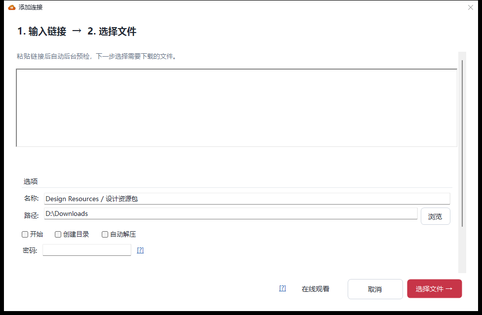
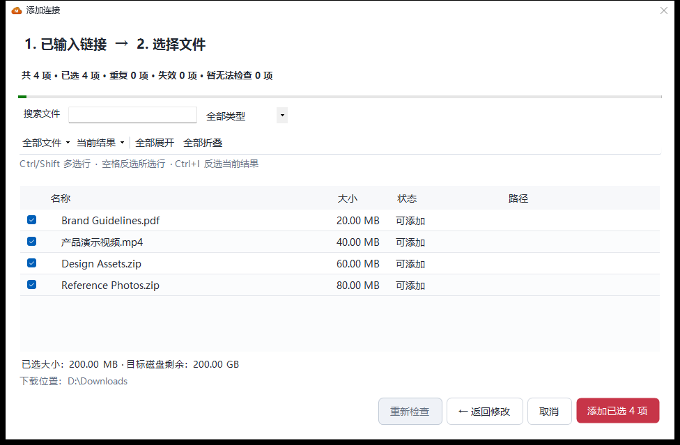

<p align="center">
  
</p>

<h1 align="center">MegaDownloader Revival</h1>

<p align="center">
  <b>The classic MEGA downloader for Windows — rebuilt for today's links.</b><br>
  Multi-threaded transfers · true resume · automatic quota recovery · batch pre-flight
</p>

<p align="center">
  <a href="../../releases/latest"></a>
  <a href="docs/CHANGELOG.md"></a>
</p>

<p align="center"><sub>If MegaDownloader helps you, <a href="https://github.com/a1175815821/MegaDownloader-Revival">give the project a ⭐</a> so more people can find it.</sub></p>

<p align="center">
  <a href="../../releases/latest"></a>
  <a href="../../releases"></a>
  
  <a href="LICENSE"></a>
  <a href="../../stargazers"></a>
</p>

<p align="center">
  <sub>Portable EXE or ZIP · no installer · no admin rights · .NET Framework 4.8 · 10 languages</sub><br>
  <sub><b>English</b> · <a href="docs/README.zh-CN.md">简体中文</a> · <a href="docs/README.zh-TW.md">繁體中文</a> · <a href="docs/README.ja-JP.md">日本語</a> · <a href="docs/README.ko-KR.md">한국어</a></sub>
</p>

> **v2.6.1 — a cleaner workbench, faster settings, automatic language selection.** Refined light and dark themes, reliable first-open menus, and a language option that follows Windows with English as the fallback. [See what's new ↓](#-whats-new-in-261)
>
> Unofficial project, not affiliated with MEGA (MEGA Ltd.).

<p align="center">
  <picture>
    <source media="(prefers-color-scheme: dark)" srcset="docs/screenshots/main-dark.png">
    <source media="(prefers-color-scheme: light)" srcset="docs/screenshots/main-light.png">
    
  </picture>
</p>
<p align="center"><sub>v2.6.1 workbench · The screenshot follows your GitHub theme. Interface shown in Simplified Chinese.</sub></p>

---

## ✨ What's new in 2.6.1

- **Clearer visual hierarchy** — a quieter sidebar, consistent typography and spacing, one progress column, and details that adapt to the window width. Stop keeps its caption; scheduled downloads gains a clock icon.
- **Menus work on first open** — all four top-level menus appear without resizing the window. The Settings button stays aligned with the sidebar.
- **Settings opens faster** — the layout avoids repeated sizing passes and the ELC account editor loads when its tab is opened. An isolated first-open measurement fell from about 8.2 s to about 1.1 s; results vary by machine.
- **Follow the Windows display language** — new configurations default to automatic selection, with regional and Simplified/Traditional Chinese matching; unsupported languages use English. Existing manual choices are kept. Change the language in Settings → General, save, then restart.
- **Updated screenshots and regression coverage** — the images below show the 2.6.1 native interface with demonstration data. See the [changelog](docs/CHANGELOG.md) for the full fixes and the one-time six-column layout migration.

## Workbench features introduced in 2.6

> **One window. Two steps. Zero guesswork.**
>
> ⚡ **5–7 s → 150–200 ms** cold start in a test setup · 500+ files imported without freezing
>
> Startup times vary by hardware and environment.

<table>
<tr>
<td width="50%" valign="top">

<b>🖥️ Rebuilt workbench</b>

One design language for light and dark: shared spacing, type scale and icon grid. Add Link is finally the primary action, sidebar groups carry their own counts, and the details panel collapses when you need the list wide.

</td>
<td width="50%" valign="top">

<b>➕ Two-step add flow</b>

Paste links, then pick files — in the same resizable window. No stacked dialogs. Go back and your links, search, expanded folders and tick marks are all still there.

</td>
</tr>
<tr>
<td valign="top">

<b>🗂️ Batch pre-flight</b>

See file names, sizes, status and relative paths <em>before</em> anything downloads. Collapsible folder tree, name search, type filter, Ctrl/Shift multi-select, and the selected size versus free space on the target disk.

</td>
<td valign="top">

<b>🔎 Task search</b>

Press <kbd>Ctrl</kbd>+<kbd>F</kbd> and search package names, file names or relative paths. Filtering combines with the current status group; <kbd>Esc</kbd> clears and restores the queue.

</td>
</tr>
<tr>
<td valign="top">

<b>⏰ Scheduled downloads</b>

A one-off appointment or a daily window, including ranges that cross midnight. The queue resumes when the window opens and pauses when it ends — settings survive a restart.

</td>
<td valign="top">

<b>⚡ 200 ms startup</b>

Cold start fell from 5–7 s to 150–200 ms: the first paint no longer queries performance counters or WMI. Parsing, package building and metadata checks moved off the UI thread, and the pre-flight list is virtualised.

</td>
</tr>
</table>

<details>
<summary><b>Everything else in 2.6 — and the fixes behind it</b></summary>

<br>

- **Duplicate detection** recognises old and new link formats by file ID + key, and checks the existing queue. Dead links and duplicates are always skipped.
- **Transient vs. permanent failures** are handled separately — a link that can't be checked because of a network blip can still be added manually.
- **New links during confirmation** are held for the next batch instead of being silently downloaded.
- **Large packages** — over 500 files — start collapsed, so importing doesn't freeze the list.
- **After adding**, the app switches to All tasks and reveals the newest package; the file tree keeps its highlight and scroll position.
- **Progress you can stop**: elapsed time, stop and re-check during parsing; a separate "Adding to download queue" state for submission.
- **DPI and theme fixes**: folder expand markers at high DPI, details panel offset after scrolling, native list background and empty-state tinting, pasted rich text no longer carries web colours.
- **Scheduled downloads** start and pause the queue within your chosen window; a manual queue pause lasts until the next window.

</details>

---

## ⚡ Up and running in 30 seconds

1. **Download** one of the two files from [Releases](../../releases/latest):

   | File | Choose it when… |
   | --- | --- |
   | **`MegaDownloader.exe`** (single file) | You want the simplest path: download and double-click — all 15 dependency DLLs are embedded |
   | **`MegaDownloader-Revival-win-x86.zip`** (portable) | You prefer an archive: extract it and run the executable |

2. **Run it** — no installer, no admin rights
   > Windows 7 SP1 or later · .NET Framework 4.8 (built into Windows 10 1903+, installer offered on older systems)

3. **Copy a MEGA link** — the clipboard monitor picks it up and adds it once you confirm

That's all. Other ways in: drag a link onto the window · **Add Link** on the toolbar · click a `mega://` protocol link in your browser.

---

## 🚀 What it does

**Download engine**

- **Multi-threaded** — several concurrent connections per file to saturate your bandwidth
- **Resume that actually works** — pause, resume, retry; survives restarts and recovers partial files
- **Folder downloads** — recursive parsing of shared folders, pick only the subfolders or files you need
- **Speed limits** — global or per task
- **Failure self-healing** — failed tasks retry on a schedule, permanently dead ones are excluded (v2.5)
- **Quota circuit breaker** — when MEGA's quota runs out the app pauses with a countdown and resumes automatically; the legacy retry mode is still there, off by default (v2.5)
- **Automatic extraction** — RAR / 7Z / ZIP on completion, including multi-volume and password-protected archives, without overwriting existing files
- **Verified output** — when the link contains a MetaMAC, downloaded files are verified before they are marked complete (v2.5.9)

**Getting links in**

- **Four ways** — clipboard monitoring · drag and drop · manual paste · `mega://` protocol
- **Batch pre-flight** — inspect and choose files before committing a large share (v2.6)
- **ELC containers** — import and export encrypted link containers; `enc` / `enc2` / `fenc` / `fenc2` / `elc` all supported

**Workbench**

- **Instant startup** — 150–200 ms cold start, no blocking WMI or performance-counter queries (v2.6)
- **Task search** — package, file and path with `Ctrl+F` (v2.6)
- **Scheduled downloads** — daily window or one-off appointment (v2.6)
- **Collapsible details** — queue stats, task list and details that yield space on narrow windows
- **Dark / light themes** — follows the system, or set manually
- **10 UI languages** — English · Español · 简体中文 · 繁體中文 · Français · Deutsch · Italiano · Português (BR) · Magyar · Română
- **Web interface** — built-in HTTP server; add tasks and watch progress from a browser, enable LAN access to push downloads from your phone

**Extras**

- **Stream while downloading** — integrated VLC playback of files that aren't finished yet
- **Streaming library** — manage regular streaming sources visually
- **Steganography tools** — hide files inside images or video (F5)

<details>
<summary><b>All supported link formats</b></summary>

<br>

- New format: `mega.nz/file/ID#KEY`, `mega.nz/folder/ID#KEY` (v1.9+), including subfolder and single-file links inside a share
- Legacy: `mega.nz/#!ID!KEY`, `mega.co.nz/#F!ID!KEY`
- Encrypted: `mega://enc?…`, `mega://enc2?…`, `mega://fenc?…`, `mega://fenc2?…`, `mega://elc?…`

```
https://mega.nz/file/abcDEFgh#IjklMNopQRstUVwxYZ1234567890
https://mega.nz/folder/abcDEFgh#IjklMNopQRstUVwxYZ1234567890
https://mega.nz/#!abcDEFgh!IjklMNopQRstUVwxYZ1234567890
mega://enc?_xlPqemSILarh5VBKbhSTFyQQQ0
```

> Support for discontinued services was removed in v2.0: MegaCrypter, YouPaste, LinkCrypter, EncrypterMe.ga and goo.gl short links.

</details>

---

## 🖼️ Interface

**Two steps from link to download**

<table>
<tr>
  <td align="center" width="50%"><b>1. Paste links</b><br></td>
  <td align="center" width="50%"><b>2. Preview and select files</b><br></td>
</tr>
</table>

<p align="center">
  <picture>
    <source media="(prefers-color-scheme: dark)" srcset="docs/screenshots/settings-dark.png">
    <source media="(prefers-color-scheme: light)" srcset="docs/screenshots/settings-general.png">
    
  </picture>
</p>
<p align="center"><sub>Settings in 2.6.1 · Automatic language selection and a scrollable layout. Demonstration data.</sub></p>

---

## 📖 Where this project came from

MegaDownloader is a MEGA download manager by Spanish developer **Andres Soliño**, known for being lightweight, stable and multi-threaded. Upstream maintenance stopped after v1.8, and MEGA has since changed its link formats (`mega.nz/file/...`, `mega.nz/folder/...`) — so the old version can't recognise new links and its core features stopped working.

This repository brings it back: v1.8 was decompiled to recover the source, and fixes and refactoring have continued on that basis — **200+ fixes and hardening** so far (crashes, silent data loss, security, compatibility), released regularly under semantic versioning.

| | Original v1.8 (abandoned 2018) | **This repo, v2.6.1** |
| --- | --- | --- |
| New `mega.nz/file` / `/folder` links | ❌ not recognised | ✅ supported since v1.9 |
| MEGA quota exhausted | hangs / errors out | ✅ auto pause + countdown resume (v2.5) |
| Failed tasks | manual retry only | ✅ scheduled self-healing (v2.5) |
| Adding a big share | paste and hope | ✅ batch pre-flight with folder tree (v2.6) |
| Finding a task | scroll the whole queue | ✅ search by package, file or path (v2.6) |
| Unattended downloads | — | ✅ daily window or one-off schedule (v2.6) |
| Startup | blocking first paint | ✅ 150–200 ms cold start — was 5–7 s (v2.6) |
| UI theme | system grey only | ✅ dark / light, follows system (v2.0) |
| Stability | — | ✅ 200+ crash / data-loss / security fixes |
| Maintenance | abandoned | ✅ active, Issues answered |

> ⚠️ **Legal notice**: This project is derived from the decompilation of third-party published software, with the sole purpose of fixing compatibility issues to restore its usability. If the original author believes this repository infringes upon their rights, please contact us via an Issue, and we will cooperate to resolve the matter.

---

## ❓ FAQ

**It says quota exceeded.**
MEGA limits free accounts and IPs. Since v2.5 the app pauses automatically and resumes after the countdown; if you can't wait, enable "quota breakthrough mode" in Settings to keep retrying.

**Where are my settings and download queue?**
In `%LOCALAPPDATA%\MegaDownloader\`. You can move or delete the program folder freely; back up that directory before reinstalling Windows.

**Do old-format links still work?**
Yes — old and new formats, `mega://` encrypted links and ELC containers are all supported (full list above).

**Does it need admin rights?**
No. It's portable and runs without elevation.

**Is there a Mac / Linux version?**
No — it's built on WinForms and is Windows-only. You can, however, enable the built-in web interface and manage downloads from any device's browser.

**Does scheduling keep my PC awake?**
No. The app must be running; it doesn't register a wake timer or run as a service.

**Found a security issue?**
Please don't open a public issue — see [SECURITY.md](SECURITY.md).

---

## 🛠️ For developers

<details>
<summary><b>Building from source</b></summary>

<br>

**Requirements**: Visual Studio 2019 or 2022 · .NET Framework 4.8 developer pack · Windows 7 SP1+

```bash
git clone https://github.com/a1175815821/MegaDownloader-Revival.git
cd MegaDownloader-Revival
# Open MegaDownloader.sln in Visual Studio, then Ctrl+Shift+B
```

Command-line build:

```bash
msbuild MegaDownloader.sln /p:Configuration=Release /p:Platform=x86
```

Output goes to `bin/<Configuration>/MegaDownloader.exe`. Build configurations: `Debug` / `Release` / `Debug_MSD` / `Release_MSD` (MegaSearchDesktop integrated edition, output to `Resources/Installer MSD/`).

Regression checks: run `.\Tests\Run-RegressionTests.ps1` in PowerShell (requires the .NET SDK). Tests use temporary files and a local HTTP server; no MEGA account is needed. See [Tests/README.md](Tests/README.md).

**Tech stack**: VB.NET · .NET Framework 4.8 · WinForms · BouncyCastle (crypto) · Newtonsoft.Json · ObjectListView · SharpCompress (decompression) · HttpServer/Fadd (web) · F5Lib (steganography)

</details>

<details>
<summary><b>Project structure</b></summary>

<br>

```
MegaDownloader/
├── Clases/                 # Core classes (crypto, download, config, theme, pre-flight, scheduling)
├── Controls/               # Custom controls
├── Forms/                  # WinForms forms, including the workbench and the two-step add flow
├── HttpModule/             # Built-in web server modules & HTML templates
├── Stegano/                # Steganography forms
├── Resources/
│   ├── DLLs/               # Third-party DLL dependencies
│   ├── Language/           # Localization XML (10 languages)
│   └── Installer MSD/      # WiX installer project
├── docs/                   # Docs and screenshots
├── Tests/                  # Download, extraction and streaming regression checks
└── MegaDownloader.sln
```

See [CONTRIBUTING](docs/CONTRIBUTING.md) for the complete directory tree and file descriptions.

</details>

---

## 📚 Documentation

| Documentation | Content |
| --- | --- |
| [CHANGELOG](docs/CHANGELOG.md) | Complete version history and per-version fix details (Simplified Chinese, authoritative) |
| [CONTRIBUTING](docs/CONTRIBUTING.md) | Contribution process, coding style, release process |
| [SECURITY](SECURITY.md) | How to report a vulnerability |
| [CODE OF CONDUCT](CODE_OF_CONDUCT.md) | Community expectations |
| [Release notes 2.6.1](https://github.com/a1175815821/MegaDownloader-Revival/releases/tag/v2.6.1) | Highlights and downloads for v2.6.1 |

The README is maintained in five languages; CONTRIBUTING exists in English and Simplified Chinese, the CHANGELOG in Simplified Chinese. If you update one, please update the others:

| Language | README | CHANGELOG | CONTRIBUTING |
| --- | --- | --- | --- |
| English | `README.md` (repo root) | `docs/CHANGELOG.md` | `docs/CONTRIBUTING.md` |
| Simplified Chinese | `docs/README.zh-CN.md` | `docs/CHANGELOG.md` | `docs/CONTRIBUTING.zh-CN.md` |
| Traditional Chinese | `docs/README.zh-TW.md` | `docs/CHANGELOG.md` | `docs/CONTRIBUTING.md` |
| Japanese | `docs/README.ja-JP.md` | `docs/CHANGELOG.md` | `docs/CONTRIBUTING.md` |
| Korean | `docs/README.ko-KR.md` | `docs/CHANGELOG.md` | `docs/CONTRIBUTING.md` |

---

## ⭐ Support this project

If MegaDownloader Revival helps you, here are the highest-impact ways to help back:

- ⭐ **Star this repo** — it's the main signal that keeps the project visible
- 🐛 [Report issues](../../issues) — many recent fixes came straight from user reports
- 🌍 Improve the [translations](docs/CONTRIBUTING.md) — 10 languages exist, native speakers wanted
- 🔗 Share it with someone still hunting for a working MEGA downloader

<a href="https://star-history.com/#a1175815821/MegaDownloader-Revival&Date">
 <picture>
   <source media="(prefers-color-scheme: dark)" srcset="https://api.star-history.com/svg?repos=a1175815821/MegaDownloader-Revival&type=Date&theme=dark" />
   <source media="(prefers-color-scheme: light)" srcset="https://api.star-history.com/svg?repos=a1175815821/MegaDownloader-Revival&type=Date" />
   
 </picture>
</a>

---

## Acknowledgments

- Original MegaDownloader author **Andres Soliño**
- Revival Project maintainer **Yingxue** (v2.0+), and everyone who filed issues or improved translations
- Open-source dependencies: [BouncyCastle](https://www.bouncycastle.org/) · [Newtonsoft.Json](https://www.newtonsoft.com/json) · [SharpCompress](https://github.com/adamhathcock/sharpcompress) · [ObjectListView](http://objectlistview.sourceforge.net/) · [7-Zip](https://www.7-zip.org/)

## License

Released under the [MIT License](LICENSE). Original copyright © 2018 Andres Soliño; copyright for the Revival Project fixes © 2026 MegaDownloader Revival Project contributors.

> Third-party DLLs in this repository are subject to their respective original licenses; users are responsible for verifying compliance.
