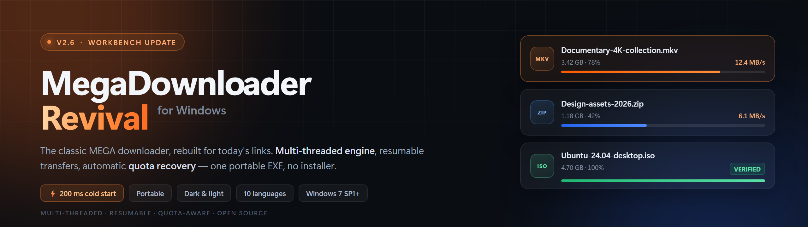
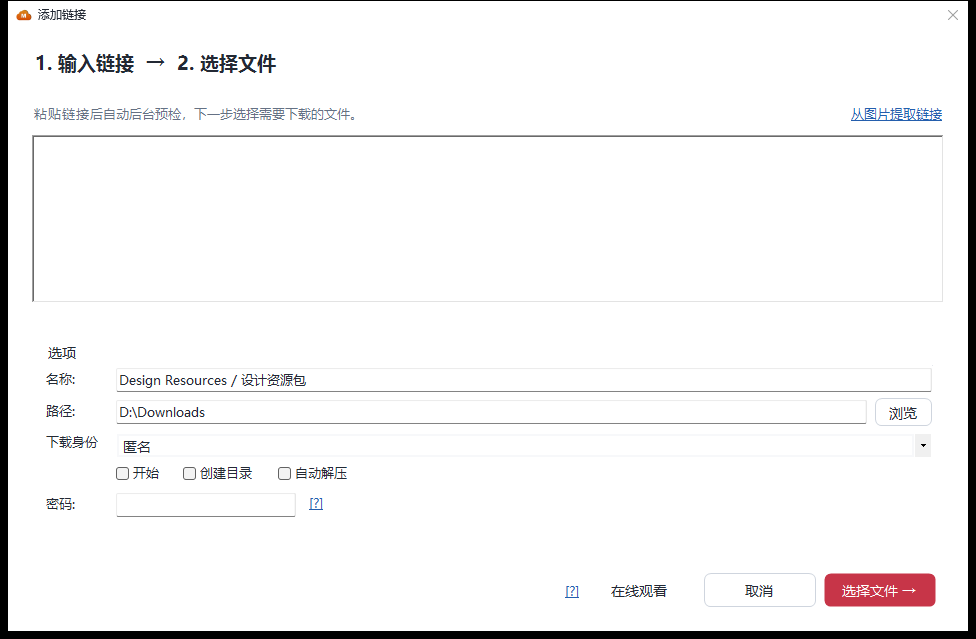
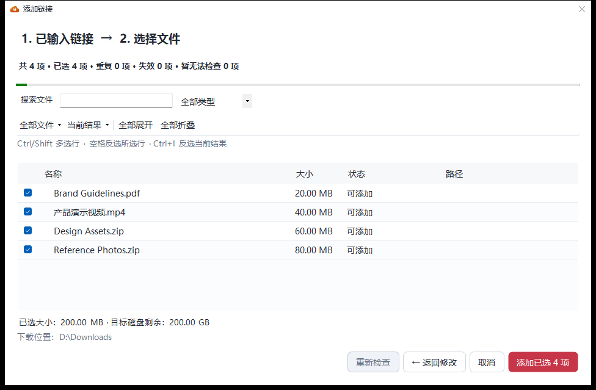
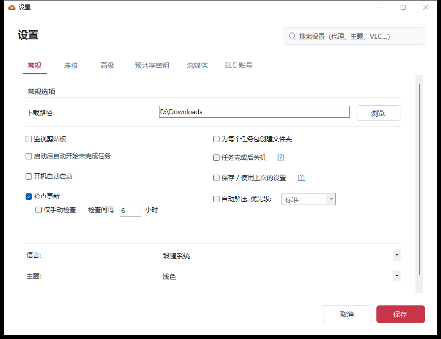
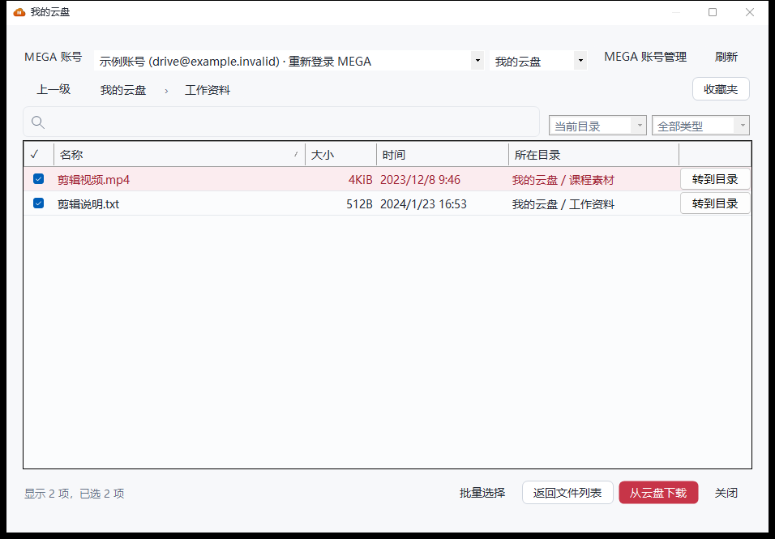
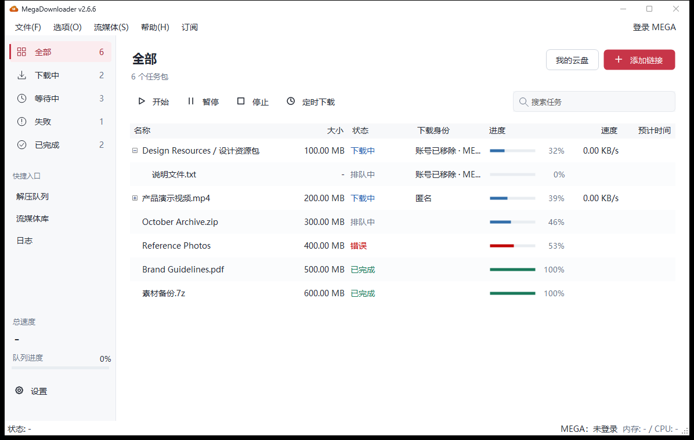

<p align="center">
  
</p>

<h1 align="center">MegaDownloader Revival</h1>

<p align="center">
  <b>The classic MEGA downloader for Windows — rebuilt for today's links.</b><br>
  Paste a <code>mega.nz/file</code> or <code>mega.nz/folder</code> link, choose files, then download; resume and automatic quota recovery are built in.<br>
  Portable single-file EXE · Unofficial project, not affiliated with MEGA Ltd.
</p>

<p align="center">
  <a href="../../releases/latest"></a>
  <a href="docs/CHANGELOG.md"></a>
</p>

<p align="center"><sub><b>English</b> · <a href="docs/README.zh-CN.md">简体中文</a> · <a href="docs/README.ru-RU.md">Русский</a></sub></p>

<p align="center"><sub>If MegaDownloader helps you, <a href="https://github.com/a1175815821/MegaDownloader-Revival">give the project a ⭐</a> so more people can find it.</sub></p>

<p align="center">
  <a href="../../releases/latest"></a>
  <a href="../../releases"></a>
  
  <a href="LICENSE"></a>
  <a href="../../stargazers"></a>
</p>

## Get started in 30 seconds

1. Download `MegaDownloader.exe` and double-click it; no installer or admin rights needed.
2. Copy a MEGA link — the app detects it automatically.
3. Confirm the link → choose files → start the download.

> v2.6.7: subscribe to a public share folder right from the file preview — pick a folder, backfill what is already there or only follow future updates, and download each subscription anonymously or with a chosen MEGA account.

<table>
<tr>
  <td align="center" width="50%"><b>1. Paste links</b><br></td>
  <td align="center" width="50%"><b>2. Preview and choose files</b><br></td>
</tr>
</table>

<p align="center"><sub>Screenshots use sample data to show the flow. If this helps, <a href="https://github.com/a1175815821/MegaDownloader-Revival">give the project a ⭐</a>; see “What it does” below for more.</sub></p>

---

## ✨ What's new in 2.6.7

- **Public folder subscriptions** — in the add-links preview, select a folder inside a public share and choose “Subscribe to this folder…”. Keep the current batch as an ordinary download, and decide separately whether the subscription backfills existing files or only follows future additions and updates. Before saving, the dialog shows how many files match, how many are already queued or delivered, and exactly how many will be added now.
- **A download identity per subscription** — each public subscription downloads anonymously or with one of your MEGA accounts. The share is always checked through its public link, so a signed-out account never hides new files; a task waiting for that account shows “Waiting for MEGA sign-in”. Changing the identity affects only files queued afterwards.
- **One subscriptions window** — the source list gains “Public shares”, so public and per-account cloud subscriptions are managed side by side: changes and status per file, check now, edit, open the delivered file, or unsubscribe without deleting queued tasks or local files.
- **Account downloads cover public folder files** — a file inside a public folder can now be transferred by the chosen MEGA account, not only standalone public file links.
- **Faster downloads and completion** — pooled buffers and AES-NI batch decryption on the download path, plus whole-chunk CBC and parallel MetaMAC verification: a 512 MiB file now verifies in about 0.2 s instead of 3.6 s, and the queue stays responsive with large task lists.
- **Verified** — 63 regression cases, **1,434 assertions** and the UI-only suite (372 assertions) all pass. [Full changelog](docs/CHANGELOG.md).

## 📦 Download options and requirements

Choose either file from [Releases](../../releases/latest):

| File | Choose it when… |
| --- | --- |
| **`MegaDownloader.exe`** (single file) | You want the simplest path: download and double-click — all 15 dependency DLLs are embedded |
| **`MegaDownloader-Revival-win-x86.zip`** (portable) | You prefer an archive: extract it and run the executable |

Requires Windows 7 SP1 or later and .NET Framework 4.8 (built into Windows 10 1903+; older systems are offered the installer). No installer or admin rights are needed.

Besides clipboard detection, links can be added by dragging them onto the window, using **Add Link** on the toolbar, or clicking a `mega://` protocol link in your browser.

---

## 🚀 What it does

**Download engine**

- **Multi-threaded** — several concurrent connections per file to saturate your bandwidth
- **Resume that actually works** — pause, resume, retry; survives restarts and recovers partial files
- **Folder downloads** — recursive parsing of shared folders, pick only the subfolders or files you need
- **Speed limits** — global, or per task for anonymous downloads
- **Failure self-healing** — failed tasks retry on a schedule, permanently dead ones are excluded (v2.5)
- **Quota circuit breaker** — when MEGA's quota runs out the app pauses with a countdown and resumes automatically; the legacy retry mode is still there, off by default (v2.5)
- **Automatic extraction** — RAR / 7Z / ZIP on completion, including multi-volume and password-protected archives, without overwriting existing files
- **Verified output** — when the link contains a MetaMAC, downloaded files are verified before they are marked complete (v2.5.9)
- **MEGA accounts** — sign in with one or more accounts, download public links through them, and rotate accounts when quota runs out (v2.6.5)

**Getting links in**

- **Four ways** — clipboard monitoring · drag and drop · manual paste · `mega://` protocol
- **Batch pre-flight** — inspect and choose files before committing a large share (v2.6)
- **ELC containers** — import and export encrypted link containers; `enc` / `enc2` / `fenc` / `fenc2` / `elc` all supported
- **Cloud drive** — browse your drive or shared folders, bind a folder to a local directory, and check for new or updated files (v2.6.5)
- **Folder subscriptions** — check bound cloud folders daily and queue new or changed files automatically (v2.6.6)
- **Public share subscriptions** — subscribe to a folder inside a public share from the preview; backfill existing files or follow only future updates, downloading with Anonymous or a chosen account (v2.6.7)

**Workbench**

- **Responsive startup** — background queue recovery and file-lock retries; no blocking WMI or performance-counter queries (v2.6.2)
- **Task search** — package, file and path with `Ctrl+F` (v2.6)
- **Scheduled downloads** — daily window or one-off appointment (v2.6)
- **Collapsible details** — queue stats, task list and details that yield space on narrow windows
- **Dark / light themes** — follows the system, or set manually
- **11 UI languages** — English · Español · 简体中文 · 繁體中文 · Русский · Français · Deutsch · Italiano · Português (BR) · Magyar · Română
- **Web interface** — built-in HTTP server; add tasks and watch progress from a browser, enable LAN access to push downloads from your phone

**Extras**

- **Stream while downloading** — integrated VLC playback of files that aren't finished yet
- **Streaming library** — manage regular streaming sources visually
- **Steganography tools** — hide files inside images or video (F5)

<details>
<summary><b>All supported link formats</b></summary>

<br>

- New format: `mega.nz/file/ID#KEY`, `mega.nz/folder/ID#KEY` (v1.9+), including subfolder and single-file links inside a share
- Legacy: `mega.nz/#!ID!KEY`, `mega.co.nz/#F!ID!KEY`
- Encrypted: `mega://enc?…`, `mega://enc2?…`, `mega://fenc?…`, `mega://fenc2?…`, `mega://elc?…`

```
https://mega.nz/file/abcDEFgh#IjklMNopQRstUVwxYZ1234567890
https://mega.nz/folder/abcDEFgh#IjklMNopQRstUVwxYZ1234567890
https://mega.nz/#!abcDEFgh!IjklMNopQRstUVwxYZ1234567890
mega://enc?_xlPqemSILarh5VBKbhSTFyQQQ0
```

> Support for discontinued services was removed in v2.0: MegaCrypter, YouPaste, LinkCrypter, EncrypterMe.ga and goo.gl short links.

</details>

---

## 🖼️ Interface

**Two steps from link to download**

<table>
<tr>
  <td align="center" width="50%"><b>1. Paste links</b><br></td>
  <td align="center" width="50%"><b>2. Preview and select files</b><br></td>
</tr>
</table>

<p align="center">
  <picture>
    <source media="(prefers-color-scheme: dark)" srcset="docs/screenshots/settings-dark.png">
    <source media="(prefers-color-scheme: light)" srcset="docs/screenshots/settings-general.png">
    
  </picture>
</p>
<p align="center"><sub>Settings in 2.6.6 · Automatic language selection and a scrollable layout. Demonstration data.</sub></p>

<table>
<tr>
  <td align="center" width="50%"><b>Cloud drive</b><br></td>
  <td align="center" width="50%"><b>Download identity per task</b><br></td>
</tr>
</table>

<p align="center"><sub>Account and cloud screens use sample data; no MEGA account is connected.</sub></p>

---

## 📖 Where this project came from

MegaDownloader is a MEGA download manager by Spanish developer **Andres Soliño**, known for being lightweight, stable and multi-threaded. Upstream maintenance stopped after v1.8, and MEGA has since changed its link formats (`mega.nz/file/...`, `mega.nz/folder/...`) — so the old version can't recognise new links and its core features stopped working.

This repository brings it back: v1.8 was decompiled to recover the source, and fixes and refactoring have continued on that basis — **200+ fixes and hardening** so far (crashes, silent data loss, security, compatibility), released regularly under semantic versioning.

| | Original v1.8 (abandoned 2018) | **This repo, v2.6.7** |
| --- | --- | --- |
| New `mega.nz/file` / `/folder` links | ❌ not recognised | ✅ supported since v1.9 |
| MEGA quota exhausted | hangs / errors out | ✅ auto pause + countdown resume (v2.5) |
| Failed tasks | manual retry only | ✅ scheduled self-healing (v2.5) |
| Adding a big share | paste and hope | ✅ batch pre-flight with folder tree (v2.6) |
| Finding a task | scroll the whole queue | ✅ search by package, file or path (v2.6) |
| Unattended downloads | — | ✅ daily window or one-off schedule (v2.6) |
| Signed-in MEGA downloads | — | ✅ multiple accounts, cloud drive, private resume (v2.6.5) |
| Startup | blocking first paint | ✅ window paints before background queue recovery (v2.6.2) |
| UI theme | system grey only | ✅ dark / light, follows system (v2.0) |
| Stability | — | ✅ 200+ crash / data-loss / security fixes |
| Maintenance | abandoned | ✅ active, Issues answered |

> ⚠️ **Legal notice**: This project is derived from the decompilation of third-party published software, with the sole purpose of fixing compatibility issues to restore its usability. If the original author believes this repository infringes upon their rights, please contact us via an Issue, and we will cooperate to resolve the matter.

---

## ❓ FAQ

**It says quota exceeded.**
MEGA limits free accounts and IPs. Since v2.5 the app pauses automatically and resumes after the countdown; if you can't wait, enable "quota breakthrough mode" in Settings to keep retrying.

**Where are my settings and download queue?**
In `%LOCALAPPDATA%\MegaDownloader\`. You can move or delete the program folder freely; back up that directory before reinstalling Windows.

**Do old-format links still work?**
Yes — old and new formats, `mega://` encrypted links and ELC containers are all supported (full list above).

**Does it need admin rights?**
No. It's portable and runs without elevation.

**Is there a Mac / Linux version?**
No — it's built on WinForms and is Windows-only. You can, however, enable the built-in web interface and manage downloads from any device's browser.

**Does scheduling keep my PC awake?**
No. The app must be running; it doesn't register a wake timer or run as a service.

**Found a security issue?**
Please don't open a public issue — see [SECURITY.md](SECURITY.md).

---

## 🛠️ For developers

<details>
<summary><b>Building from source</b></summary>

<br>

**Requirements**: Visual Studio 2019 or 2022 · .NET Framework 4.8 developer pack · Windows 7 SP1+

```bash
git clone https://github.com/a1175815821/MegaDownloader-Revival.git
cd MegaDownloader-Revival
# Open MegaDownloader.sln in Visual Studio, then Ctrl+Shift+B
```

Command-line build:

```bash
msbuild MegaDownloader.sln /p:Configuration=Release /p:Platform=x86
```

Output goes to `bin/<Configuration>/MegaDownloader.exe`. Build configurations: `Debug` / `Release` / `Debug_MSD` / `Release_MSD` (MegaSearchDesktop integrated edition, output to `Resources/Installer MSD/`).

Regression checks: run `.\Tests\Run-RegressionTests.ps1` in PowerShell (requires the .NET SDK). Tests use temporary files and a local HTTP server; no MEGA account is needed. See [Tests/README.md](Tests/README.md).

The build compresses and embeds the prebuilt x64 MEGA account module from `Native/MegaAccount/prebuilt/x64/`. Regular releases reuse it. See [Native/MegaAccount/README.md](Native/MegaAccount/README.md) for rebuild instructions.

**Tech stack**: VB.NET · .NET Framework 4.8 · WinForms · BouncyCastle (crypto) · Newtonsoft.Json · ObjectListView · SharpCompress (decompression) · HttpServer/Fadd (web) · F5Lib (steganography)

</details>

<details>
<summary><b>Project structure</b></summary>

<br>

```
MegaDownloader/
├── Clases/                 # Core classes (crypto, download, config, theme, pre-flight, scheduling)
├── Controls/               # Custom controls
├── Forms/                  # WinForms forms, including the workbench and the two-step add flow
├── HttpModule/             # Built-in web server modules & HTML templates
├── Stegano/                # Steganography forms
├── Resources/
│   ├── DLLs/               # Third-party DLL dependencies
│   ├── Language/           # Localization XML (11 languages)
│   └── Installer MSD/      # WiX installer project
├── docs/                   # Docs and screenshots
├── Tests/                  # Download, extraction and streaming regression checks
└── MegaDownloader.sln
```

See [CONTRIBUTING](docs/CONTRIBUTING.md) for the complete directory tree and file descriptions.

</details>

---

## 📚 Documentation

| Documentation | Content |
| --- | --- |
| [CHANGELOG](docs/CHANGELOG.md) | Complete version history and per-version fix details (Simplified Chinese, authoritative) |
| [CONTRIBUTING](docs/CONTRIBUTING.md) | Contribution process, coding style, release process |
| [SECURITY](SECURITY.md) | How to report a vulnerability |
| [CODE OF CONDUCT](CODE_OF_CONDUCT.md) | Community expectations |
| [Release notes 2.6.7](https://github.com/a1175815821/MegaDownloader-Revival/releases/tag/v2.6.7) | Highlights and downloads for v2.6.7 |

The README is maintained in three languages; CONTRIBUTING exists in English and Simplified Chinese, the CHANGELOG in Simplified Chinese. If you update one, please update the others:

| Language | README | CHANGELOG | CONTRIBUTING |
| --- | --- | --- | --- |
| English | `README.md` (repo root) | `docs/CHANGELOG.md` | `docs/CONTRIBUTING.md` |
| Simplified Chinese | `docs/README.zh-CN.md` | `docs/CHANGELOG.md` | `docs/CONTRIBUTING.zh-CN.md` |
| Russian | `docs/README.ru-RU.md` | `docs/CHANGELOG.md` | `docs/CONTRIBUTING.md` |

---

## ⭐ Support this project

If MegaDownloader Revival helps you, here are the highest-impact ways to help back:

- ⭐ **Star this repo** — it's the main signal that keeps the project visible
- 🐛 [Report issues](../../issues) — many recent fixes came straight from user reports
- 🌍 Improve the [translations](docs/CONTRIBUTING.md) — 11 languages exist, native speakers wanted
- 🔗 Share it with someone still hunting for a working MEGA downloader

<a href="https://star-history.com/#a1175815821/MegaDownloader-Revival&Date">
 <picture>
   <source media="(prefers-color-scheme: dark)" srcset="https://api.star-history.com/svg?repos=a1175815821/MegaDownloader-Revival&type=Date&theme=dark" />
   <source media="(prefers-color-scheme: light)" srcset="https://api.star-history.com/svg?repos=a1175815821/MegaDownloader-Revival&type=Date" />
   
 </picture>
</a>

---

## Acknowledgments

- Original MegaDownloader author **Andres Soliño**
- Revival Project maintainer **Yingxue** (v2.0+), and everyone who filed issues or improved translations
- Open-source dependencies: [BouncyCastle](https://www.bouncycastle.org/) · [Newtonsoft.Json](https://www.newtonsoft.com/json) · [SharpCompress](https://github.com/adamhathcock/sharpcompress) · [ObjectListView](http://objectlistview.sourceforge.net/) · [7-Zip](https://www.7-zip.org/)

## License

Released under the [MIT License](LICENSE). Original copyright © 2018 Andres Soliño; copyright for the Revival Project fixes © 2026 MegaDownloader Revival Project contributors.

> Third-party DLLs in this repository are subject to their respective original licenses; users are responsible for verifying compliance.
