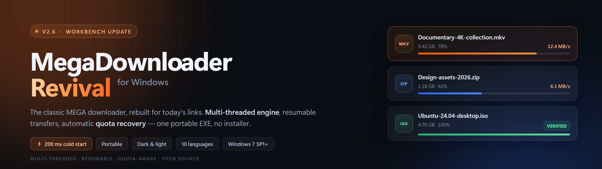
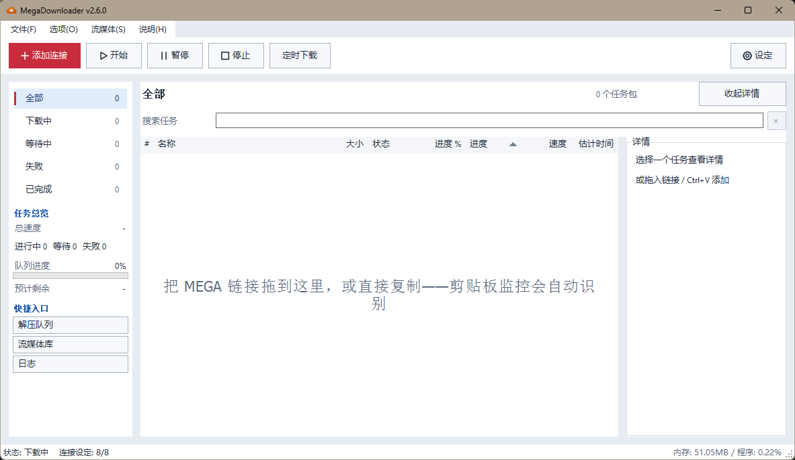
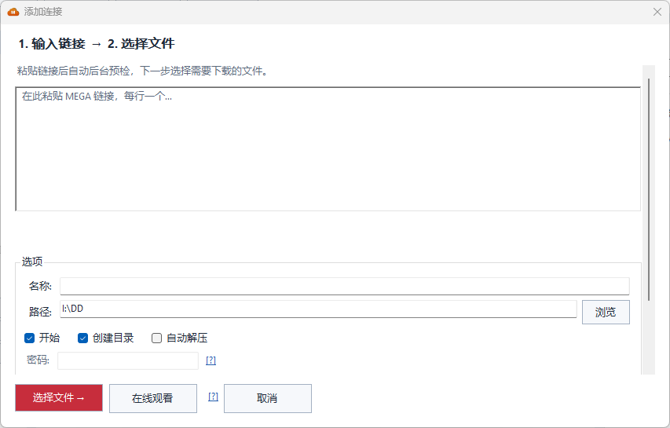
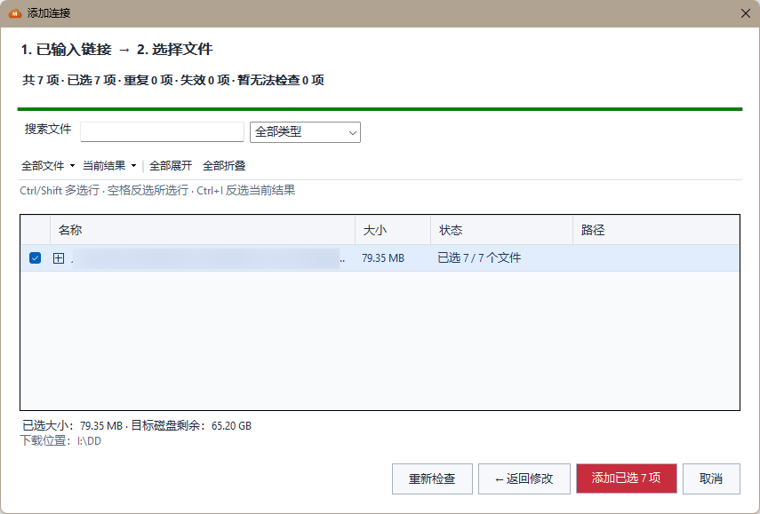

<p align="center">
  
</p>

<h1 align="center">MegaDownloader 復活プロジェクト</h1>

<p align="center">
  <b>定番 MEGA ダウンローダーを、現在のリンク形式のために作り直しました。</b><br>
  マルチスレッド転送 · 確実なレジューム · クォータ自動回復 · ダウンロード前の一括確認
</p>

<p align="center">
  <a href="../../../releases/latest"></a>
  <a href="CHANGELOG.md"></a>
</p>

<p align="center"><sub>お役に立ったら、<a href="https://github.com/a1175815821/MegaDownloader-Revival">⭐ Star</a> でプロジェクトを応援してください。</sub></p>

<p align="center">
  <a href="../../../releases/latest"></a>
  <a href="../../../releases"></a>
  
  <a href="../LICENSE"></a>
  <a href="../../../stargazers"></a>
</p>

<p align="center">
  <sub>単体 EXE または ZIP · インストール不要 · 管理者権限不要 · .NET Framework 4.8 · UI 10 言語</sub><br>
  <sub><a href="../README.md">English</a> · <a href="README.zh-CN.md">简体中文</a> · <a href="README.zh-TW.md">繁體中文</a> · <b>日本語</b> · <a href="README.ko-KR.md">한국어</a></sub>
</p>

> **v2.6「ワークベンチ」のご紹介。** UI を全面的に作り直し、リンク追加を 2 ステップの流れに集約して一括事前確認に対応。タスク検索とスケジュールダウンロードも追加しました。復活プロジェクト開始以来、最大の更新です。コールドスタートも **150〜200 ミリ秒** まで短縮しました。[新機能を見る ↓](#-26-の新機能)
>
> MEGA（MEGA Ltd.）とは無関係の非公式プロジェクトです。

<p align="center">
  <picture>
    <source media="(prefers-color-scheme: dark)" srcset="screenshots/v2.6-workbench-dark.png">
    <source media="(prefers-color-scheme: light)" srcset="screenshots/v2.6-workbench-light.png">
    
  </picture>
</p>
<p align="center"><sub>v2.6 ワークベンチ · 画像は GitHub のテーマに合わせて切り替わります。画面の言語は簡体字中国語です。</sub></p>

---

## ✨ 2.6 の新機能

> **ウィンドウは 1 つ、操作は 2 ステップ、迷うところはゼロ。**
>
> ⚡ **コールドスタートの実測 5〜7 秒 → 150〜200 ミリ秒** · 500 ファイル超のインポートでも固まらない
>
> 起動時間はハードウェアや実行環境によって異なります。

<table>
<tr>
<td width="50%" valign="top">

<b>🖥️ ワークベンチを作り直し</b>

ライト／ダークで共通の余白・文字サイズ・アイコングリッド。「リンク追加」がようやく主役になり、サイドバーの各グループが個別に件数を表示。詳細パネルは畳んでリストに幅を譲れます。

</td>
<td width="50%" valign="top">

<b>➕ 2 ステップの追加</b>

同じウィンドウでリンクを貼り、次にファイルを選択。ダイアログが重なりません。戻っても、リンク・検索語・開いたフォルダ・チェックはそのまま残ります。

</td>
</tr>
<tr>
<td valign="top">

<b>🗂️ 一括事前確認</b>

ダウンロード前にファイル名・サイズ・状態・相対パスを確認。フォルダツリーは折りたたみ可能で、名前検索、種類フィルタ、Ctrl/Shift 複数選択、選択合計サイズと保存先の空き容量表示に対応します。

</td>
<td valign="top">

<b>🔎 タスク検索</b>

<kbd>Ctrl</kbd>+<kbd>F</kbd> でパッケージ名・ファイル名・相対パスを検索。現在のステータスグループと組み合わせて絞り込み、<kbd>Esc</kbd> で解除してキュー全体に戻ります。

</td>
</tr>
<tr>
<td valign="top">

<b>⏰ スケジュールダウンロード</b>

日時の一度きりの予約、または毎日の時間帯を設定。日をまたぐ時間帯にも対応し、開始時刻に自動再開、終了時刻に自動停止。設定は再起動後も保持されます。

</td>
<td valign="top">

<b>⚡ 起動 200 ミリ秒</b>

コールドスタートが 5〜7 秒から 150〜200 ミリ秒に短縮。初回描画でパフォーマンスカウンターや WMI を同期的に読まなくなりました。リンク解析・パッケージ構築・メタデータ確認も UI スレッドから分離し、事前確認リストは仮想化しています。

</td>
</tr>
</table>

<details>
<summary><b>2.6 のその他の変更と、その裏にある修正</b></summary>

<br>

- **重複検出**：新旧リンク形式をファイル ID + キーで識別し、既存キューとも照合。重複と無効リンクは常にスキップします。
- **一時的な失敗と恒久的な失敗を分離**：ネットワークの瞬断で確認できなかった通常リンクは、手動で選択して追加できます。
- **確認中に届いた新しいリンク**は次回分として保持し、勝手にダウンロードしません。
- **大きなパッケージ**（500 ファイル超）は初期状態で折りたたみ、インポート直後のリスト凍結を防ぎます。
- **追加後**は「すべてのタスク」に切り替えて最新パッケージを表示。ファイルツリーのハイライトとスクロール位置は維持されます。
- **進捗が見えて、止められる**：解析中は経過時間を表示して停止／再確認が可能。送信時は「ダウンロードキューに追加」を明示します。
- **DPI とテーマの修正**：高 DPI のフォルダ展開マーカー、詳細スクロール後のレイアウトずれ、ネイティブリスト背景と空状態のテーマ適用、書式付き貼り付けの文字色持ち込み。
- **キューのスケジュール管理**：設定時間帯にダウンロードを再開し、終了時に停止します。キュー全体を手動停止した場合は次の時間帯まで保持されます。

</details>

---

## ⚡ 30 秒で開始

1. [Releases](../../../releases/latest) からどちらかをダウンロード：

   | ファイル | 向いている人 |
   | --- | --- |
   | **`MegaDownloader.exe`**（単体） | とにかく簡単に：ダウンロードしてダブルクリック。15 個の依存 DLL を内蔵 |
   | **`MegaDownloader-Revival-win-x86.zip`**（ポータブル） | アーカイブ派：解凍して実行 |

2. **実行する** —— インストール不要、管理者権限も不要
   > Windows 7 SP1 以降 · .NET Framework 4.8（Windows 10 1903 以降は標準搭載、それ以前は案内に従って導入）

3. **MEGA のリンクをコピー** —— クリップボード監視が検出し、確認後にキューへ追加します

これだけで使えます。他にも、ウィンドウへのドラッグ＆ドロップ · ツールバーの「リンク追加」 · ブラウザで `mega://` リンクをクリック、が使えます。

---

## 🚀 できること

**ダウンロードエンジン**

- **マルチスレッド** —— 1 ファイルに複数接続して帯域を使い切る
- **本当に効くレジューム** —— 一時停止・再開・エラー再試行。再起動後も継続し、途中のファイルを再利用
- **フォルダダウンロード** —— 共有フォルダを再帰的に解析し、必要なサブフォルダやファイルだけを選択
- **速度制限** —— 全体またはタスク単位
- **失敗の自己修復** —— 失敗タスクを定期的に再試行し、恒久的に失敗したものは除外（v2.5）
- **クォータ遮断** —— MEGA のクォータ切れで自動停止しカウントダウン、時間経過で自動再開。旧「クォータ突破」モードも既定オフで残存（v2.5）
- **自動解凍** —— 完了時に RAR / 7Z / ZIP を解凍。分割・パスワード付きに対応し、同名ファイルは上書きしません
- **成果物の検証** —— リンクに MetaMAC が含まれる場合、ダウンロードしたファイルを検証してから完了扱いにします（v2.5.9）

**リンクの取り込み**

- **4 つの方法** —— クリップボード監視 · ドラッグ＆ドロップ · 手動貼り付け · `mega://` プロトコル
- **一括事前確認** —— 大きな共有も中身を見てから選択（v2.6）
- **ELC コンテナ** —— 暗号化リンクコンテナの入出力。`enc` / `enc2` / `fenc` / `fenc2` / `elc` に対応

**ワークベンチ**

- **高速起動** —— コールドスタート 150〜200 ミリ秒、WMI とパフォーマンスカウンターの同期読み取りなし（v2.6）
- **タスク検索** —— パッケージ名・ファイル名・パスを `Ctrl+F` で（v2.6）
- **スケジュールダウンロード** —— 毎日の時間帯または一度きりの予約（v2.6）
- **詳細パネルを折りたたみ** —— キュー統計・タスクリスト・詳細の 3 分割。狭いウィンドウでは自動で幅を譲ります
- **ダーク／ライトテーマ** —— システム設定に追従、手動指定も可能
- **UI 10 言語** —— English · Español · 简体中文 · 繁體中文 · Français · Deutsch · Italiano · Português (BR) · Magyar · Română
- **Web インターフェース** —— 内蔵 HTTP サーバー。ブラウザからタスク追加と進捗確認。LAN アクセスを有効にすればスマートフォンからも投入可能

**その他**

- **ダウンロードしながら再生** —— VLC を統合し、未完了の動画をストリーミング再生
- **ストリーミングライブラリ** —— よく見る配信元を視覚的に管理
- **ステガノグラフィ** —— 画像や動画の中にファイルを隠す（F5）

<details>
<summary><b>対応リンク形式の一覧</b></summary>

<br>

- 新形式：`mega.nz/file/ID#KEY`、`mega.nz/folder/ID#KEY`（v1.9 以降）。共有内のサブフォルダ・単一ファイルリンクにも対応
- 旧形式：`mega.nz/#!ID!KEY`、`mega.co.nz/#F!ID!KEY`
- 暗号化：`mega://enc?…`、`mega://enc2?…`、`mega://fenc?…`、`mega://fenc2?…`、`mega://elc?…`

```
https://mega.nz/file/abcDEFgh#IjklMNopQRstUVwxYZ1234567890
https://mega.nz/folder/abcDEFgh#IjklMNopQRstUVwxYZ1234567890
https://mega.nz/#!abcDEFgh!IjklMNopQRstUVwxYZ1234567890
mega://enc?_xlPqemSILarh5VBKbhSTFyQQQ0
```

> v2.0 で終了したサービスへの対応を削除しました：MegaCrypter、YouPaste、LinkCrypter、EncrypterMe.ga、goo.gl 短縮リンク。

</details>

---

## 🖼️ インターフェース

**リンクからダウンロードまでの 2 ステップ**

<table>
<tr>
  <td align="center" width="50%"><b>1. リンクを貼り付け</b><br></td>
  <td align="center" width="50%"><b>2. 事前確認してファイルを選択</b><br></td>
</tr>
</table>

---

## 📖 このプロジェクトの由来

MegaDownloader はスペインの開発者 **Andres Soliño** による MEGA ダウンロードマネージャーで、軽量・安定・マルチスレッドで知られています。本家は v1.8 で更新を停止し、その後 MEGA がリンク形式（`mega.nz/file/...`、`mega.nz/folder/...`）を変更したため、旧版は新しいリンクを認識できず主要機能が動作しなくなりました。

本リポジトリはそれを復活させたものです。v1.8 を逆コンパイルしてソースを復元し、そこから修正とリファクタリングを継続しています。これまでに **200 件以上の修正と堅牢化**（クラッシュ、無言のデータ損失、セキュリティ、互換性）を行い、セマンティックバージョニングで継続的にリリースしています。

|  | オリジナル v1.8（2018 年で停止） | **本リポジトリ v2.6** |
| --- | --- | --- |
| 新 `mega.nz/file` / `/folder` リンク | ❌ 認識しない | ✅ v1.9 以降で対応 |
| MEGA のクォータ切れ | 停止・エラー | ✅ 自動停止＋カウントダウン再開（v2.5） |
| 失敗したタスク | 手動再試行のみ | ✅ 定期的な自己修復（v2.5） |
| 大きな共有の追加 | 貼って祈るだけ | ✅ 一括事前確認＋フォルダツリー（v2.6） |
| タスク探し | キュー全体をスクロール | ✅ パッケージ・ファイル・パスで検索（v2.6） |
| 無人でのダウンロード | — | ✅ 毎日の時間帯または一度きりの予約（v2.6） |
| 起動時間 | 初回描画がブロック | ✅ コールドスタート 150〜200 ミリ秒（従来 5〜7 秒、v2.6） |
| UI テーマ | システムのグレーのみ | ✅ ダーク／ライト、システム追従（v2.0） |
| 安定性 | — | ✅ 200 件以上のクラッシュ／データ損失／セキュリティ修正 |
| メンテナンス | 停止 | ✅ 活発に維持、Issue に回答 |

> ⚠️ **法的注意**：本プロジェクトは第三者が公開したソフトウェアを逆コンパイルしたものに由来し、互換性の問題を修正して再び使えるようにすることのみを目的としています。原作者が権利侵害と判断した場合は Issue でご連絡ください。協力して対応します。

---

## ❓ FAQ

**クォータ不足 / quota exceeded と表示されます。**
MEGA は無料アカウントと IP にダウンロード制限を設けています。v2.5 以降は自動で停止し、カウントダウン後に再開します。待てない場合は設定の「クォータ突破モード」で再試行を続けられます。

**設定とダウンロードキューはどこにありますか？**
`%LOCALAPPDATA%\MegaDownloader\` です。プログラムのフォルダは移動・削除しても設定に影響しません。Windows を再インストールする前にこのフォルダをバックアップしてください。

**旧形式のリンクはまだ使えますか？**
使えます。新旧形式、`mega://` 暗号化リンク、ELC コンテナすべてに対応しています（一覧は上記）。

**管理者権限は必要ですか？**
不要です。ポータブルで、昇格なしで動作します。

**Mac / Linux 版はありますか？**
ありません。WinForms ベースで Windows 専用です。ただし内蔵 Web インターフェースを有効にすれば、任意の端末のブラウザからダウンロードを管理できます。

**スケジュールは PC をスリープから復帰させますか？**
いいえ。アプリは起動したままである必要があり、ウェイクタイマーの登録やサービスとしての常駐は行いません。

**セキュリティ問題を見つけたら？**
公開 Issue は立てず、[SECURITY](../SECURITY.md) の手順でご連絡ください。

---

## 🛠️ 開発者向け

<details>
<summary><b>ソースからビルド</b></summary>

<br>

**必要条件**：Visual Studio 2019 または 2022 · .NET Framework 4.8 Developer Pack· Windows 7 SP1 以降

```bash
git clone https://github.com/a1175815821/MegaDownloader-Revival.git
cd MegaDownloader-Revival
# Visual Studio で MegaDownloader.sln を開き、Ctrl+Shift+B
```

コマンドラインでのビルド：

```bash
msbuild MegaDownloader.sln /p:Configuration=Release /p:Platform=x86
```

出力は `bin/<Configuration>/MegaDownloader.exe`。ビルド構成は `Debug` / `Release` / `Debug_MSD` / `Release_MSD`（MegaSearchDesktop 統合版、`Resources/Installer MSD/` へ出力）。

回帰テスト：PowerShell で `.\Tests\Run-RegressionTests.ps1` を実行（.NET SDK が必要）。一時ファイルとローカル HTTP サーバーを使うため、MEGA アカウントは不要です。詳細は [Tests/README.md](../Tests/README.md)。

**技術スタック**：VB.NET · .NET Framework 4.8 · WinForms · BouncyCastle（暗号）· Newtonsoft.Json · ObjectListView · SharpCompress（解凍）· HttpServer/Fadd（Web）· F5Lib（ステガノグラフィ）

</details>

<details>
<summary><b>プロジェクト構成</b></summary>

<br>

```
MegaDownloader/
├── Clases/                 # コアクラス（暗号、ダウンロード、設定、テーマ、事前確認、スケジュール）
├── Controls/               # カスタムコントロール
├── Forms/                  # WinForms フォーム（ワークベンチ、2 ステップ追加など）
├── HttpModule/             # 内蔵 Web サーバーモジュールと HTML テンプレート
├── Stegano/                # ステガノグラフィ用フォーム
├── Resources/
│   ├── DLLs/               # サードパーティ DLL
│   ├── Language/           # ローカライズ XML（10 言語）
│   └── Installer MSD/      # WiX インストーラープロジェクト
├── docs/                   # ドキュメント、スクリーンショット、リリースノート
├── Tests/                  # ダウンロード・解凍・ストリーミングの回帰テスト
└── MegaDownloader.sln
```

ディレクトリツリーの詳細は [CONTRIBUTING](CONTRIBUTING.md) を参照してください。

</details>

---

## 📚 ドキュメント

| ドキュメント | 内容 |
| --- | --- |
| [CHANGELOG](CHANGELOG.md) | 完全なバージョン履歴と各版の修正詳細（簡体中文、正本） |
| [CONTRIBUTING](CONTRIBUTING.md) | 貢献の流れ、コードスタイル、リリース手順 |
| [SECURITY](../SECURITY.md) | 脆弱性の報告方法 |
| [CODE OF CONDUCT](../CODE_OF_CONDUCT.md) | コミュニティの行動規範 |
| [2.6 リリースノート](release-notes/v2.6.0.md) | GitHub Release の本文として使う文面 |

README は 5 言語で手動メンテナンスしています。CONTRIBUTING は英語と簡体中文、CHANGELOG は簡体中文のみです。更新時は揃えてください：

| 言語 | README | CHANGELOG | CONTRIBUTING |
| --- | --- | --- | --- |
| English | `README.md`（ルート） | `docs/CHANGELOG.md` | `docs/CONTRIBUTING.md` |
| 简体中文 | `docs/README.zh-CN.md` | `docs/CHANGELOG.md` | `docs/CONTRIBUTING.zh-CN.md` |
| 繁體中文 | `docs/README.zh-TW.md` | `docs/CHANGELOG.md` | `docs/CONTRIBUTING.md` |
| 日本語 | `docs/README.ja-JP.md` | `docs/CHANGELOG.md` | `docs/CONTRIBUTING.md` |
| 한국어 | `docs/README.ko-KR.md` | `docs/CHANGELOG.md` | `docs/CONTRIBUTING.md` |

---

## ⭐ プロジェクトを支援する

MegaDownloader Revival が役に立ったら、次の形での支援が最も効果的です：

- ⭐ **Star を付ける** —— プロジェクトが目に留まる最も直接的なシグナルです
- 🐛 [Issue を立てる](../../../issues) —— 最近の修正の多くはユーザー報告から生まれています
- 🌍 [翻訳](CONTRIBUTING.md) を改善する —— 10 言語ありますが、ネイティブの校正者が不足しています
- 🔗 動く MEGA ダウンローダーを探している人に教える

<a href="https://star-history.com/#a1175815821/MegaDownloader-Revival&Date">
 <picture>
   <source media="(prefers-color-scheme: dark)" srcset="https://api.star-history.com/svg?repos=a1175815821/MegaDownloader-Revival&type=Date&theme=dark" />
   <source media="(prefers-color-scheme: light)" srcset="https://api.star-history.com/svg?repos=a1175815821/MegaDownloader-Revival&type=Date" />
   
 </picture>
</a>

---

## 謝辞

- オリジナル MegaDownloader 作者 **Andres Soliño**
- 復活プロジェクトのメンテナー **Yingxue**（v2.0+）、および Issue や翻訳で貢献した皆さん
- オープンソース依存：[BouncyCastle](https://www.bouncycastle.org/) · [Newtonsoft.Json](https://www.newtonsoft.com/json) · [SharpCompress](https://github.com/adamhathcock/sharpcompress) · [ObjectListView](http://objectlistview.sourceforge.net/) · [7-Zip](https://www.7-zip.org/)

## ライセンス

[MIT License](../LICENSE) で公開しています。オリジナルの著作権 © 2018 Andres Soliño、復活プロジェクトの修正に関する著作権 © 2026 MegaDownloader Revival Project contributors。

> リポジトリ内のサードパーティ DLL はそれぞれの元のライセンスに従います。利用者が適合性を確認してください。
