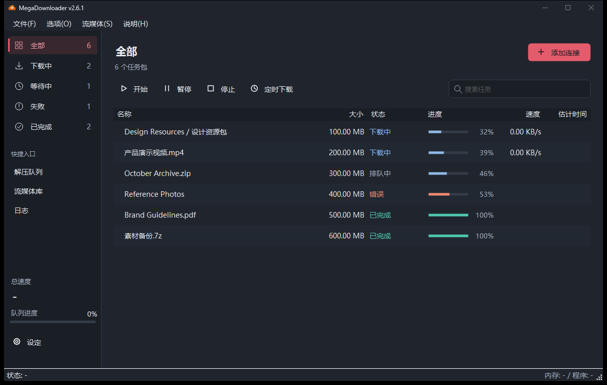

# MegaDownloader 부활 프로젝트

**언어**: [English](../../README.md) · [简体中文](README.zh-CN.md) · [繁體中文](README.zh-TW.md) · [日本語](README.ja-JP.md) · **한국어**

> 클래식 MEGA 다운로더를 오늘날의 MEGA에서 다시 사용할 수 있도록: 새 링크 형식 지원, 멀티스레드 가속, 이어받기, quota 자동 복구를 단일 실행 파일·설치 없이.
> 비공식 프로젝트이며 MEGA(MEGA Ltd.)와는 무관합니다.

[](../../LICENSE)
[](https://dotnet.microsoft.com/)
[](https://dotnet.microsoft.com/download/dotnet-framework)
[](https://docs.microsoft.com/dotnet/visual-basic/)
[](../../actions/workflows/build.yml)
[](../../releases/latest)
[](../../releases)
[](../../stargazers)

> ⭐ 이 프로젝트가 시간을 아껴주었다면 오른쪽 위의 Star를 눌러 주세요. 독립 오픈소스가 더 많은 사람에게 닿는 가장 좋은 방법입니다.

## 스크린샷

| 라이트 테마 | 다크 테마 |
| --- | --- |
|  |  |

---

## ⚡ 30초 만에 시작하기

1. [Releases](../../releases/latest)에서 둘 중 하나를 다운로드:

   | 파일 | 이런 분께 |
   | --- | --- |
   | **`MegaDownloader.exe`** (단일 파일) | 가장 간편하게: 다운로드 후 더블클릭만. 의존 DLL 15개를 모두 내장 |
   | **`MegaDownloader-Revival-win-x86.zip`** (포터블) | 안정성 우선: 원하는 폴더에 압축을 풀고 실행. 단일 파일 버전이 백신 오탐을 받는다면 이쪽을 |

2. 더블클릭으로 실행 — 설치 불필요, 관리자 권한 불필요
   > 시스템 요구 사항: Windows 7 SP1 이상. .NET Framework 4.8 (Windows 10 1903+ 기본 탑재, 구버전 OS는 안내에 따라 설치)
3. MEGA 링크를 복사 — 프로그램이 클립보드를 자동 인식하고, 확인하면 다운로드 대기열에 추가됩니다

여기까지면 다운로드를 바로 쓸 수 있습니다. 이후는 필요할 때: [기능](#-무엇을-할-수-있나요) → [프로젝트 배경과 비교](#-이-프로젝트는-어디서-왔나) → [FAQ](#-faq) → [개발자용](#️-개발자용).

링크 추가 방법은 더 있습니다: 링크를 메인 창으로 드래그 · 도구 모음의 「링크 추가」로 붙여넣기 · 브라우저에서 `mega://` 프로토콜 링크 클릭.

> 🆕 **최신 버전 [v2.5.8](../../releases/latest)** (2026-10-22): 느린 다운로드가 "정지"로 오판되던 문제 수정 · RAR 분할·암호 지원 수정 · 다크 모드 메뉴 막대 · 설정이 조용히 사라지던 문제 근治. 전체 이력은 [CHANGELOG](CHANGELOG.md)에서.

---

## 🚀 무엇을 할 수 있나요

**다운로드 엔진**

- **멀티스레드** — 파일 하나에 여러 연결을 동시에 열어 회선을 최대한 활용
- **이어받기** — 일시정지 / 재개 / 오류 재시도. 프로그램을 재시작해도 이어서
- **폴더 다운로드** — 공유 폴더 전체를 재귀적으로 분석하고, 필요한 하위 폴더나 파일만 선택 가능
- **속도 제한** — 전역 또는 작업별
- **실패 자가 치유** (v2.5) — 실패한 작업을 주기적으로 자동 재시도, 영구 실패는 자동 제외
- **quota 서킷 브레이커** (v2.5) — MEGA 다운로드 quota가 소진되면 자동 일시정지 후 카운트다운, 시간이 되면 자동 재개. 구식 「quota 돌파」 재시도 모드로 전환도 가능 (기본값은 꺼짐)
- **자동 압축 해제** — 다운로드 완료 후 RAR / 7Z / ZIP 자동 해제, 분할·암호 포함

**편의성과 원격**

- **링크 추가 4가지 방법** — 클립보드 자동 인식 / 드래그 앤 드롭 / 수동 붙여넣기 / `mega://` 프로토콜
- **웹 인터페이스** — 내장 HTTP 서버로 브라우저에서 작업 추가·진행 상황 확인. LAN 접근을 켜면 스마트폰에서도
- **ELC 컨테이너** — 암호화 링크 컨테이너 가져오기/내보내기. `enc` / `enc2` / `fenc` / `fenc2` / `elc` 모두 지원

**인터페이스와 경험**

- **다운받으면서 재생** — VLC 통합으로 다운로드 중인 영상을 스트리밍 재생
- **스트리밍 라이브러리** — 자주 보는 스트리밍 소스를 시각적으로 관리
- **다크 / 라이트 테마** (v2.0) — 시스템 설정을 따라 자동 전환, 수동 지정도 가능
- **10가지 UI 언어** — English · Español · 简体中文 · 繁體中文 · Français · Deutsch · Italiano · Português (BR) · Magyar · Română, 추가 가능
- **스테가노그래피** — 이미지 / 영상에 파일을 숨기기 (F5 스테가노)

<details>
<summary><b>지원하는 링크 형식 전체 (클릭하여 펼치기)</b></summary>

- 신형: `mega.nz/file/ID#KEY`, `mega.nz/folder/ID#KEY` (v1.9+)
- 구형: `mega.nz/#!ID!KEY`, `mega.co.nz/#F!ID!KEY`
- 암호화: `mega://enc?…`, `mega://enc2?…`, `mega://fenc?…`, `mega://fenc2?…`, `mega://elc?…`

링크 예시:

```
https://mega.nz/file/abcDEFgh#IjklMNopQRstUVwxYZ1234567890
https://mega.nz/folder/abcDEFgh#IjklMNopQRstUVwxYZ1234567890
https://mega.nz/#!abcDEFgh!IjklMNopQRstUVwxYZ1234567890
mega://enc?_xlPqemSILarh5VBKbhSTFyQQQ0
```

> v2.0부터 서비스가 종료된 아래 항목들은 지원하지 않습니다: MegaCrypter, YouPaste, LinkCrypter, EncrypterMe.ga, goo.gl 단축 링크.

</details>

---

## 📖 이 프로젝트는 어디서 왔나

MegaDownloader는 스페인 개발자 **Andres Soliño**가 만든 MEGA 다운로드 관리자로, 가볍고 안정적이며 멀티스레드를 지원하는 것으로 유명했습니다. 원 프로젝트는 v1.8 이후 개발이 중단되었고, 그 사이 MEGA가 링크 형식을 바꿔버려(`mega.nz/file/...`, `mega.nz/folder/...`) 구버전은 새 링크를 인식하지 못하고 핵심 기능이 동작하지 않게 되었습니다.

이 저장소가 그것을 되살렸습니다: v1.8을 역컴파일해 소스 코드를 확보하고, 그 위에 수정과 리팩터링을 이어가고 있습니다. 지금까지 **200건 이상의 수정과 강화**(크래시, 조용한 데이터 유실, 보안, 호환성)를 쌓았고, 시맨틱 버저닝으로 꾸준히 릴리스하고 있습니다.

|  | 구버전 v1.8 (2018년 중단) | **이 저장소 v2.5.x** |
| --- | --- | --- |
| 신형 `mega.nz/file` / `/folder` 링크 | ❌ 인식 불가 | ✅ v1.9부터 지원 |
| MEGA quota 초과 | 멈춤 / 오류 | ✅ 자동 일시정지 + 카운트다운 재개 (v2.5) |
| 실패한 작업 | 수동 재시도만 | ✅ 주기적 자가 치유 (v2.5) |
| UI 테마 | 시스템 회색뿐 | ✅ 다크 / 라이트, 시스템 연동 (v2.0) |
| 안정성 | — | ✅ 200건 이상의 크래시 / 데이터 유실 / 보안 수정 |
| 유지보수 | 중단됨 | ✅ 활발히 유지보수, Issue에도 응답 |

> ⚠️ **법적 고지**: 이 프로젝트는 제3자가 배포한 소프트웨어의 역컴파일에서 파생되었으며, 목적은 호환성 문제를 수정해 다시 쓸 수 있게 하는 것에 한정됩니다. 원 저작자가 권리를 침해받았다고 생각하신다면 Issue로 연락해 주세요. 협조하여 처리하겠습니다.

---

## ❓ FAQ

**백신이 바이러스로 탐지합니다.**
단일 파일 버전은 mpress로 패킹되어 있어 일부 백신에서 오탐이 날 수 있습니다. zip 버전을 사용하거나 소스에서 직접 빌드하세요 — 모든 공식 Release는 GitHub Actions가 소스에서 자동으로 빌드하며, 과정은 공개되어 있습니다.

**quota exceeded가 표시됩니다.**
MEGA는 무료 계정과 IP에 다운로드 quota 제한을 둡니다. v2.5부터는 자동으로 일시정지하고 카운트다운 후 재개합니다. 기다리기 어렵다면 설정에서 「quota 돌파 모드」를 켜서 계속 재시도할 수 있습니다.

**설정과 다운로드 대기열은 어디에 저장되나요?**
`%LOCALAPPDATA%\MegaDownloader\` 입니다. 프로그램 폴더는 자유롭게 옮기거나 삭제해도 설정에 영향이 없습니다. Windows 재설치 전에 이 폴더를 백업하세요.

**구형 링크도 다운로드되나요?**
네. 신구 형식, `mega://` 암호화 링크, ELC 컨테이너 모두 지원합니다 (전체 목록은 위의 접기 블록).

**관리자 권한이 필요한가요?**
아니요. 설치도, 관리자 권한도 필요 없습니다.

**Mac / Linux 버전은 없나요?**
없습니다 — WinForms 기반이라 Windows 전용입니다. 다만 내장 웹 인터페이스를 켜면 스마트폰이나 다른 기기의 브라우저에서 다운로드를 관리할 수 있습니다.

---

## 🛠️ 개발자용

<details>
<summary><b>소스에서 빌드 (클릭하여 펼치기)</b></summary>

**필요 환경**: Visual Studio 2013 이상 (솔루션은 VS2013 형식) · .NET Framework 4.8 SDK (VS와 함께 설치) · Windows 7 SP1+

```bash
git clone https://github.com/a1175815821/MegaDownloader-Revival.git
cd MegaDownloader-Revival
# MegaDownloader.sln을 Visual Studio로 열고 Ctrl+Shift+B
```

명령줄 빌드:

```bash
msbuild MegaDownloader.sln /p:Configuration=Release /p:Platform=x86
```

결과물은 `bin/<Configuration>/MegaDownloader.exe`. 빌드 구성: `Debug` / `Release` / `Debug_MSD` / `Release_MSD` (MegaSearchDesktop 통합 버전, 출력 위치 `Resources/Installer MSD/`).

**기술 스택**: VB.NET · .NET Framework 4.8 · WinForms · BouncyCastle (암호화) · Newtonsoft.Json · ObjectListView · SharpCompress (압축 해제) · HttpServer/Fadd (웹) · F5Lib (스테가노)

</details>

<details>
<summary><b>프로젝트 구조 (클릭하여 펼치기)</b></summary>

```
MegaDownloader/
├── Clases/                 # 핵심 클래스 (암호화, 다운로드, 설정, 테마, 업데이트)
├── Controls/               # 사용자 정의 컨트롤
├── Forms/                  # WinForms 폼 (12개)
├── HttpModule/             # 내장 웹 서버 모듈과 HTML 템플릿
├── Stegano/                # 스테가노그래피 폼
├── Resources/
│   ├── DLLs/               # 서드파티 DLL 의존성
│   ├── Language/           # 다국어 XML (10개 언어)
│   └── Installer MSD/      # WiX 설치 패키지 프로젝트
├── docs/                   # 문서 (README / CHANGELOG / CONTRIBUTING)
└── MegaDownloader.sln
```

전체 디렉터리 트리와 파일 설명은 [CONTRIBUTING](CONTRIBUTING.zh-CN.md)을 참고하세요.

</details>

---

## 📚 문서

| 문서 | 내용 |
| --- | --- |
| [CHANGELOG](CHANGELOG.md) | 전체 버전 이력과 버전별 수정 내역 (간체 중국어만) |
| [CONTRIBUTING](CONTRIBUTING.zh-CN.md) | 기여 절차, 코드 스타일, 릴리스 절차 |

README와 CONTRIBUTING은 각 언어별로 수동 관리됩니다. 수정 시 다른 언어도 동기화해 주세요:

| 언어 | README | CHANGELOG | CONTRIBUTING |
| --- | --- | --- | --- |
| English | `README.md` (저장소 루트) | `docs/CHANGELOG.md` | `docs/CONTRIBUTING.md` |
| 简体中文 | `docs/README.zh-CN.md` | `docs/CHANGELOG.md` | `docs/CONTRIBUTING.zh-CN.md` |
| 繁體中文 | `docs/README.zh-TW.md` | `docs/CHANGELOG.md` | `docs/CONTRIBUTING.md` |
| 日本語 | `docs/README.ja-JP.md` | `docs/CHANGELOG.md` | `docs/CONTRIBUTING.md` |
| 한국어 | `docs/README.ko-KR.md` | `docs/CHANGELOG.md` | `docs/CONTRIBUTING.md` |

> 简体中文이 원본(기준판)입니다.

---

## ⭐ 이 프로젝트를 응원하기

이 도구는 공식 홈페이지도, 홍보 예산도 없습니다. 여러분의 Star가 더 많은 사람에게 닿는 방법입니다:

- ⭐ 오른쪽 위 **Star** 클릭 — 「MEGA 다운로더」를 검색하는 사람이 찾을 수 있게
- 🐛 문제가 생기면 [Issue 보고](../../issues) — 최근 수정의 많은 부분이 사용자 신고에서 나왔습니다
- 🌍 [번역](CONTRIBUTING.zh-CN.md) 개선에 참여 — 10개 언어가 있지만 모국어 검수가 필요합니다
- 🔗 아직 MEGA 다운로더를 찾고 있는 지인에게 알려주기

<a href="https://star-history.com/#a1175815821/MegaDownloader-Revival&Date">
 <picture>
   <source media="(prefers-color-scheme: dark)" srcset="https://api.star-history.com/svg?repos=a1175815821/MegaDownloader-Revival&type=Date&theme=dark" />
   <source media="(prefers-color-scheme: light)" srcset="https://api.star-history.com/svg?repos=a1175815821/MegaDownloader-Revival&type=Date" />
   
 </picture>
</a>

---

## 감사의 말

- 원본 MegaDownloader의 저자 **Andres Soliño**
- 부활 프로젝트 관리자 **Yingxue** (v2.0+), 그리고 Issue를 보고하고 번역을 개선해 준 모든 기여자
- 오픈소스 의존성: [BouncyCastle](https://www.bouncycastle.org/) · [Newtonsoft.Json](https://www.newtonsoft.com/json) · [SharpCompress](https://github.com/adamhathcock/sharpcompress) · [ObjectListView](http://objectlistview.sourceforge.net/) · [7-Zip](https://www.7-zip.org/) · [mpress](https://www.matcode.com/mpress.htm)

## 라이선스

[MIT License](../../LICENSE)로 공개. 원본 저작권 © 2018 Andres Soliño, 부활 프로젝트 수정 부분의 저작권 © 2026 MegaDownloader Revival Project 기여자.

> 저장소 내 서드파티 DLL은 각자의 원 라이선스를 따릅니다. 사용자는 준수 여부를 직접 확인해야 합니다.
