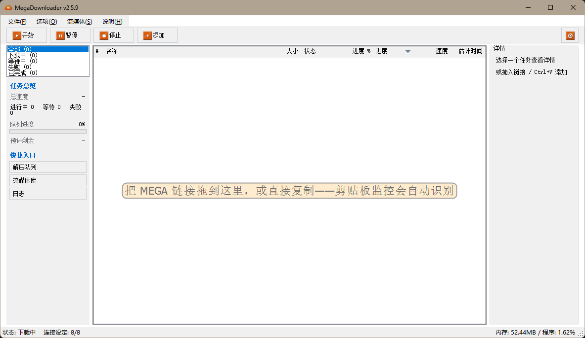
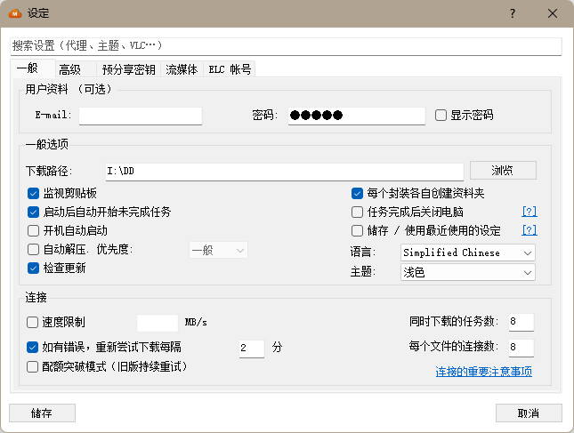
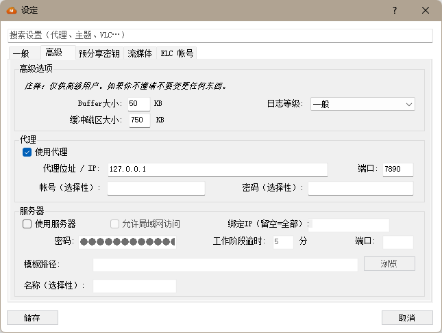

# MegaDownloader Revival Project

**Languages**: **English** · [简体中文](README.zh-CN.md) · [繁體中文](README.zh-TW.md) · [日本語](README.ja-JP.md) · [한국어](README.ko-KR.md)

> The classic MEGA downloader, back in working order: supports the new mega.nz link formats, with multi-threaded downloads, resume support, and automatic quota recovery — in a single portable executable.
> Unofficial project, not affiliated with MEGA (MEGA Ltd.).

**[Download for Windows](../../../releases/latest)** · Portable EXE or ZIP · Windows 7 SP1+ · .NET Framework 4.8

[](../LICENSE)
[](https://dotnet.microsoft.com/)
[](https://dotnet.microsoft.com/download/dotnet-framework)
[](https://docs.microsoft.com/dotnet/visual-basic/)
[](../../../actions/workflows/build.yml)
[](../../../releases/latest)
[](../../../releases)
[](../../../stargazers)

## Screenshots

<picture>
  <source media="(prefers-color-scheme: dark)" srcset="screenshots/main-dark.png">
  <source media="(prefers-color-scheme: light)" srcset="screenshots/main-light.png">
  
</picture>

Live queue stats and shortcuts on the left, the task list in the middle, details for the selected task on the right. Drop a MEGA link anywhere in the window, or just copy one — the clipboard monitor picks it up. The theme follows your system setting, and so does the screenshot above.

| Settings → General | Settings → Advanced |
| :---: | :---: |
| [](screenshots/settings-general.png) | [](screenshots/settings-advanced.png) |
| Download folder, clipboard monitoring, autostart, language, theme, speed limit, retries | Buffers and log level, proxy, built-in web server and LAN access |

<sub>Screenshots from v2.5.9, captured in the Simplified Chinese UI — 10 interface languages available.</sub>

---

## ⚡ Up and Running in 30 Seconds

1. Download one of the two files from [Releases](../../../releases/latest):

   | File | Choose it when… |
   | --- | --- |
   | **`MegaDownloader.exe`** (single file) | You want the simplest path: download and double-click — all 15 dependency DLLs are embedded |
   | **`MegaDownloader-Revival-win-x86.zip`** (portable) | You prefer an archive: extract it and run the executable |

2. Double-click to run — no installer, no admin rights needed
   > System requirements: Windows 7 SP1 or later; .NET Framework 4.8 (built into Windows 10 1903+, installer offered on older systems)
3. Copy any MEGA link — the program detects the clipboard automatically and adds it to the queue once you confirm

That's all you need to start downloading. Read on as needed: [Features](#-what-it-does) → [Background & comparison](#-where-this-project-came-from) → [FAQ](#-faq) → [For developers](#️-for-developers).

Other ways to add links: drag a link onto the main window · paste via the **Add Link** toolbar button · click a `mega://` protocol link in your browser.

> 🆕 **Latest release: [v2.5.9](../../../releases/latest)** (2026-10-28): same-name downloads no longer interfere · extraction preserves existing files · completed downloads are verified and reused · streaming byte-range corruption fixed. Full history in the [CHANGELOG](CHANGELOG.md).

---

## 🚀 What It Does

**Download engine**

- **Multi-threaded** — multiple concurrent connections per file to max out your bandwidth
- **Resume** — pause, resume, retry on errors; survives restarts
- **Folder downloads** — recursively parses shared folders; pick only the subfolders or files you need
- **Speed limits** — global or per-task
- **Failure self-healing** (v2.5) — failed tasks retry automatically on a schedule; permanently dead ones are excluded
- **Quota circuit breaker** (v2.5) — when MEGA's download quota runs out, the app pauses with a countdown and resumes automatically; the legacy "quota breakthrough" retry mode is still available (off by default)
- **Automatic decompression** — RAR / 7Z / ZIP extracted on completion, including multi-volume and password-protected archives

**Convenience & remote control**

- **Four ways to add links** — clipboard monitoring / drag-and-drop / manual paste / `mega://` protocol
- **Web interface** — built-in HTTP server: add tasks and watch progress from a browser; enable LAN access to push downloads from your phone
- **ELC containers** — import and export encrypted link containers; `enc` / `enc2` / `fenc` / `fenc2` / `elc` all supported

**Interface & experience**

- **Stream while downloading** — integrated VLC playback of files that are still downloading
- **Streaming library** — manage your regular streaming sources visually
- **Dark / light themes** (v2.0) — follows the system automatically, or set manually
- **10 UI languages** — English · Español · 简体中文 · 繁體中文 · Français · Deutsch · Italiano · Português (BR) · Magyar · Română, extendable
- **Steganography tools** — hide files inside images / video (F5 steganography)

<details>
<summary><b>All supported link formats (click to expand)</b></summary>

- New format: `mega.nz/file/ID#KEY`, `mega.nz/folder/ID#KEY` (v1.9+)
- Legacy: `mega.nz/#!ID!KEY`, `mega.co.nz/#F!ID!KEY`
- Encrypted: `mega://enc?…`, `mega://enc2?…`, `mega://fenc?…`, `mega://fenc2?…`, `mega://elc?…`

Link examples:

```
https://mega.nz/file/abcDEFgh#IjklMNopQRstUVwxYZ1234567890
https://mega.nz/folder/abcDEFgh#IjklMNopQRstUVwxYZ1234567890
https://mega.nz/#!abcDEFgh!IjklMNopQRstUVwxYZ1234567890
mega://enc?_xlPqemSILarh5VBKbhSTFyQQQ0
```

> Support for the following discontinued services was removed in v2.0: MegaCrypter, YouPaste, LinkCrypter, EncrypterMe.ga, and goo.gl short links.

</details>

---

## 📖 Where This Project Came From

MegaDownloader is a MEGA download manager by Spanish developer **Andres Soliño**, known for being lightweight, stable, and multi-threaded. Upstream maintenance stopped after v1.8, and MEGA has since changed its link formats (`mega.nz/file/...`, `mega.nz/folder/...`) — so the old version can't recognize new links and its core features stopped working.

This repository brings it back: v1.8 was decompiled to recover the source, and fixes and refactoring have continued on that basis — **200+ fixes and hardening** so far (crashes, silent data loss, security, compatibility), released regularly under semantic versioning.

| | Original v1.8 (abandoned 2018) | **This repo, v2.5.x** |
| --- | --- | --- |
| New `mega.nz/file` / `/folder` links | ❌ not recognized | ✅ supported since v1.9 |
| MEGA quota exhausted | hangs / errors out | ✅ auto pause + countdown resume (v2.5) |
| Failed tasks | manual retry only | ✅ scheduled self-healing (v2.5) |
| UI theme | system grey only | ✅ dark / light, follows system (v2.0) |
| Stability | — | ✅ 200+ crash / data-loss / security fixes |
| Maintenance | abandoned | ✅ active, Issues answered |

> ⚠️ **Legal notice**: This project is derived from the decompilation of third-party published software, with the sole purpose of fixing compatibility issues to restore its usability. If the original author believes this repository infringes upon their rights, please contact us via an Issue, and we will cooperate to resolve the matter.

---

## ❓ FAQ

**My antivirus flags the download.**
If your antivirus flags a download, check its warning and verify the source before running it. You can inspect the [build workflow](../../../actions/workflows/build.yml), try the ZIP package, or build from source yourself. A different package does not guarantee that a warning will disappear.

**It says quota exceeded.**
MEGA limits free accounts and IPs. Since v2.5 the app pauses automatically and resumes after the countdown; if you can't wait, enable "quota breakthrough mode" in Settings to keep retrying.

**Where are my settings and download queue?**
In `%LOCALAPPDATA%\MegaDownloader\`. You can move or delete the program folder freely; back up that directory before reinstalling Windows.

**Do old-format links still work?**
Yes — old and new formats, `mega://` encrypted links, and ELC containers are all supported (full list above).

**Does it need admin rights?**
No. It's portable and runs without elevation.

**Is there a Mac / Linux version?**
No — it's built on WinForms and is Windows-only. You can, however, enable the built-in web interface and manage downloads from any device's browser.

---

## 🛠️ For Developers

<details>
<summary><b>Building from source (click to expand)</b></summary>

**Requirements**: Visual Studio 2013 or newer (the solution is in VS2013 format) · .NET Framework 4.8 SDK (installed with VS) · Windows 7 SP1+

```bash
git clone https://github.com/a1175815821/MegaDownloader-Revival.git
cd MegaDownloader-Revival
# Open MegaDownloader.sln in Visual Studio, then Ctrl+Shift+B
```

Command-line build:

```bash
msbuild MegaDownloader.sln /p:Configuration=Release /p:Platform=x86
```

Output goes to `bin/<Configuration>/MegaDownloader.exe`. Build configurations: `Debug` / `Release` / `Debug_MSD` / `Release_MSD` (MegaSearchDesktop integrated edition, output to `Resources/Installer MSD/`).

Regression checks: run `.\Tests\Run-RegressionTests.ps1` in PowerShell (requires the .NET SDK). Tests use temporary files and a local HTTP server; no MEGA account is needed. See [Tests/README.md](../Tests/README.md).

**Tech stack**: VB.NET · .NET Framework 4.8 · WinForms · BouncyCastle (crypto) · Newtonsoft.Json · ObjectListView · SharpCompress (decompression) · HttpServer/Fadd (web) · F5Lib (steganography)

</details>

<details>
<summary><b>Project structure (click to expand)</b></summary>

```
MegaDownloader/
├── Clases/                 # Core classes (crypto, download, config, theme, updates)
├── Controls/               # Custom controls
├── Forms/                  # WinForms forms (12)
├── HttpModule/             # Built-in web server modules & HTML templates
├── Stegano/                # Steganography forms
├── Resources/
│   ├── DLLs/               # Third-party DLL dependencies
│   ├── Language/           # Localization XML (10 languages)
│   └── Installer MSD/      # WiX installer project
├── docs/                   # Docs (README / CHANGELOG / CONTRIBUTING)
├── Tests/                  # Download, extraction and streaming regression checks
└── MegaDownloader.sln
```

See [CONTRIBUTING](CONTRIBUTING.md) for the complete directory tree and file descriptions.

</details>

---

## 📚 Documentation

| Documentation | Content |
| --- | --- |
| [CHANGELOG](CHANGELOG.md) | Complete version history and per-version fix details (Simplified Chinese only) |
| [CONTRIBUTING](CONTRIBUTING.md) | Contribution process, coding style, release process |

README is hand-maintained in all five languages; CONTRIBUTING exists in English and Simplified Chinese only, and CHANGELOG in Simplified Chinese only. If you update one, please update the others as well:

| Language | README | CHANGELOG | CONTRIBUTING |
| --- | --- | --- | --- |
| English | `README.md` (repo root) | `docs/CHANGELOG.md` | `docs/CONTRIBUTING.md` |
| Simplified Chinese | `docs/README.zh-CN.md` | `docs/CHANGELOG.md` | `docs/CONTRIBUTING.zh-CN.md` |
| Traditional Chinese | `docs/README.zh-TW.md` | `docs/CHANGELOG.md` | `docs/CONTRIBUTING.md` |
| Japanese | `docs/README.ja-JP.md` | `docs/CHANGELOG.md` | `docs/CONTRIBUTING.md` |
| Korean | `docs/README.ko-KR.md` | `docs/CHANGELOG.md` | `docs/CONTRIBUTING.md` |

> Simplified Chinese is the authoritative source.

---

## ⭐ Support This Project

If MegaDownloader Revival helps you, here are a few ways to support it:

- ⭐ Click **Star** in the top-right to support the project
- 🐛 [Report issues](../../../issues) — many recent fixes came straight from user reports
- 🌍 Help improve the [translations](CONTRIBUTING.md) — 10 languages exist, native speakers wanted
- 🔗 Share it with friends still hunting for a MEGA downloader

<a href="https://star-history.com/#a1175815821/MegaDownloader-Revival&Date">
 <picture>
   <source media="(prefers-color-scheme: dark)" srcset="https://api.star-history.com/svg?repos=a1175815821/MegaDownloader-Revival&type=Date&theme=dark" />
   <source media="(prefers-color-scheme: light)" srcset="https://api.star-history.com/svg?repos=a1175815821/MegaDownloader-Revival&type=Date" />
   
 </picture>
</a>

---

## Acknowledgments

- Original MegaDownloader author **Andres Soliño**
- Revival Project maintainer **Yingxue** (v2.0+), and everyone who filed issues or improved translations
- Open-source dependencies: [BouncyCastle](https://www.bouncycastle.org/) · [Newtonsoft.Json](https://www.newtonsoft.com/json) · [SharpCompress](https://github.com/adamhathcock/sharpcompress) · [ObjectListView](http://objectlistview.sourceforge.net/) · [7-Zip](https://www.7-zip.org/)

## License

Released under the [MIT License](../LICENSE). Original copyright © 2018 Andres Soliño; copyright for the Revival Project fixes © 2026 MegaDownloader Revival Project contributors.

> Third-party DLLs in this repository are subject to their respective original licenses; users are responsible for verifying compliance.
