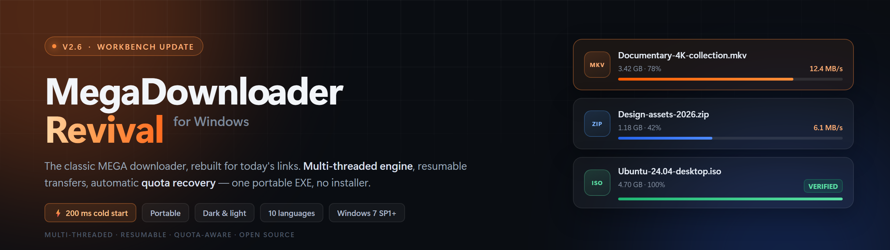
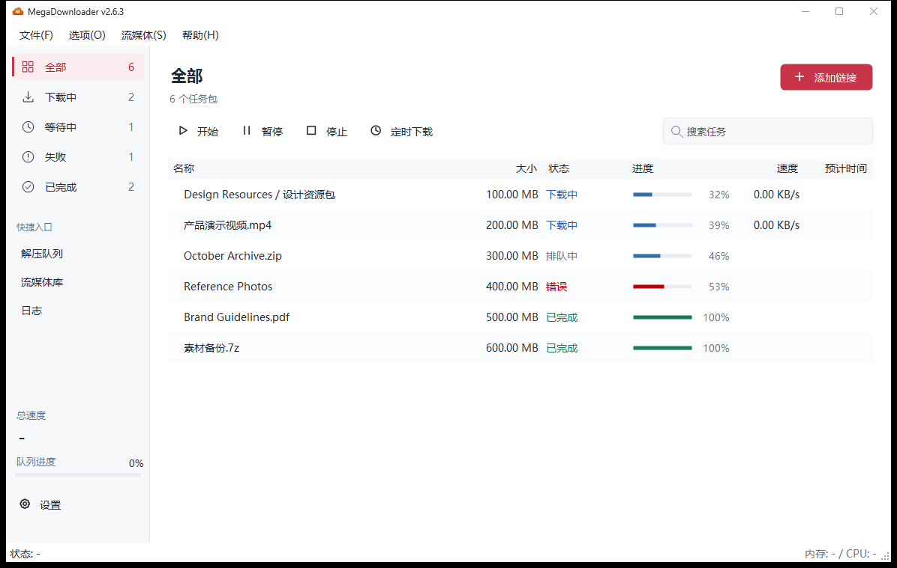
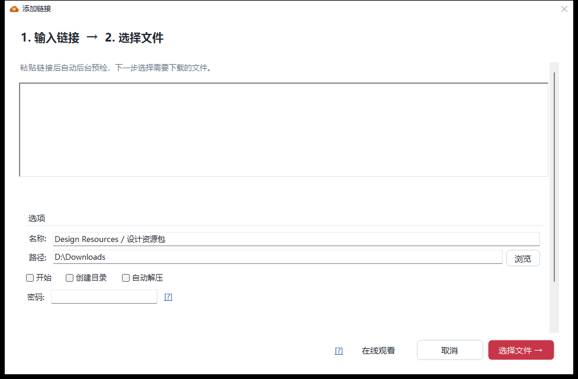
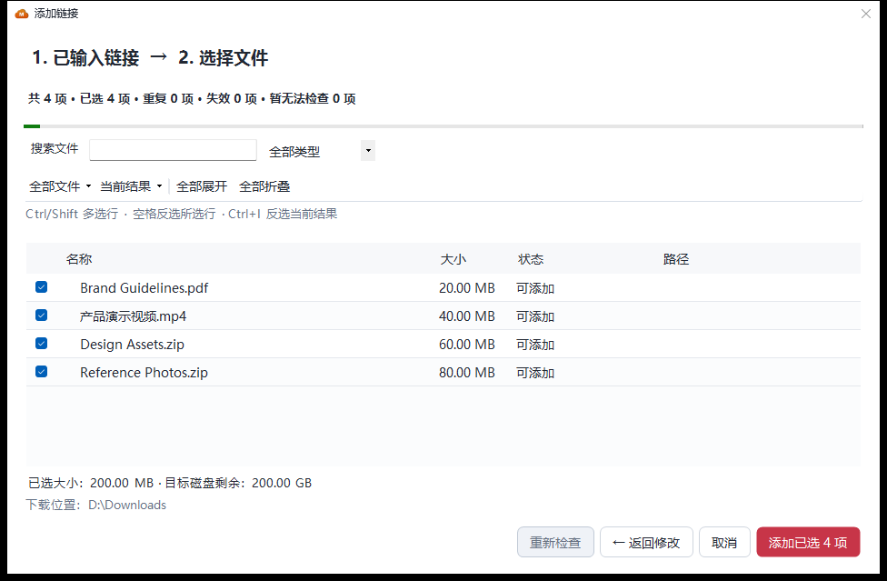
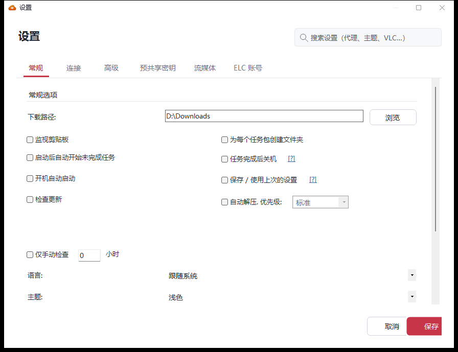

<p align="center">
  
</p>

<h1 align="center">MegaDownloader Revival</h1>

<p align="center">
  <b>Классический MEGA-загрузчик для Windows — воссозданный под современные ссылки.</b><br>
  Многопоточная загрузка · настоящее докачивание · автовосстановление после квоты · массовая предпроверка
</p>

<p align="center">
  <a href="../../../releases/latest"></a>
  <a href="CHANGELOG.md"></a>
</p>

<p align="center"><sub>Если MegaDownloader вам полезен, поставьте проекту <a href="https://github.com/a1175815821/MegaDownloader-Revival">⭐ Star</a>, чтобы его нашло больше людей.</sub></p>

<p align="center">
  <a href="../../../releases/latest"></a>
  <a href="../../../releases"></a>
  
  <a href="../LICENSE"></a>
  <a href="../../../stargazers"></a>
</p>

<p align="center">
  <sub>Однофайловый EXE или ZIP · без установки · без прав администратора · .NET Framework 4.8 · 11 языков интерфейса</sub><br>
  <sub><a href="../README.md">English</a> · <a href="README.zh-CN.md">简体中文</a> · <b>Русский</b></sub>
</p>

> **v2.6.1 — аккуратнее рабочий стол, быстрее настройки, автоматический выбор языка.** Улучшены светлая и тёмная темы, меню открываются с первого раза, язык интерфейса следует за Windows с откатом на английский. [Что нового ↓](#-что-нового-в-261)
>
> Неофициальный проект, не связан с MEGA (MEGA Ltd.).

<p align="center">
  <picture>
    <source media="(prefers-color-scheme: dark)" srcset="screenshots/main-dark.png">
    <source media="(prefers-color-scheme: light)" srcset="screenshots/main-light.png">
    
  </picture>
</p>
<p align="center"><sub>Рабочий стол v2.6.1 · Скриншот следует за темой GitHub. Интерфейс показан на упрощённом китайском.</sub></p>

---

## ✨ Что нового в 2.6.1

- **Более чёткая визуальная иерархия** — спокойнее боковая панель, единая типографика и отступы, одна колонка прогресса, детали адаптируются к ширине окна. Кнопка «Стоп» сохранила подпись; у загрузок по расписанию появились иконки часов.
- **Меню работают с первого открытия** — все четыре меню верхней панели появляются без изменения размера окна. Кнопка настроек остаётся выровненной с боковой панелью.
- **Настройки открываются быстрее** — раскладка избавлена от повторных проходов разметки, редактор аккаунта ELC загружается при открытии вкладки. В изолированном замере первое открытие ускорилось примерно с 8,2 с до 1,1 с; результат зависит от машины.
- **Следование языку Windows** — новые конфигурации по умолчанию выбирают язык автоматически, с учётом региональных вариантов и различия упрощённого/традиционного китайского; неподдерживаемые языки откатываются на английский. Ручной выбор сохраняется. Язык меняется в «Настройки → Общие», затем сохраните и перезапустите приложение.
- **Обновлённые скриншоты и регрессионное покрытие** — изображения ниже показывают нативный интерфейс 2.6.1 с демонстрационными данными. Полный список исправлений и разовую миграцию на шестиколоночную раскладку см. в [списке изменений](CHANGELOG.md).

## Возможности рабочего стола, появившиеся в 2.6

> **Одно окно. Два шага. Никаких догадок.**
>
> ⚡ **5–7 с → 150–200 мс** холодный старт в тестовой конфигурации · 500+ файлов импортируются без зависаний
>
> Время запуска зависит от оборудования и окружения.

<table>
<tr>
<td width="50%" valign="top">

<b>🖥️ Переработанный рабочий стол</b>

Единый дизайн-язык для светлой и тёмной темы: общие отступы, типографика и сетка иконок. «Добавить ссылку» наконец-то стало главным действием, группы боковой панели несут собственные счётчики, а панель деталей сворачивается, когда нужен широкий список.

</td>
<td width="50%" valign="top">

<b>➕ Добавление в два шага</b>

Вставьте ссылки, затем выберите файлы — в том же окне с изменяемым размером. Без нагромождения диалогов. Вернётесь назад — ссылки, поисковый запрос, раскрытые папки и галочки всё ещё на месте.

</td>
</tr>
<tr>
<td valign="top">

<b>🗂️ Массовая предпроверка</b>

Смотрите имена файлов, размеры, статус и относительные пути <em>до</em> начала загрузки. Сворачиваемое дерево папок, поиск по имени, фильтр по типу, мультивыбор Ctrl/Shift и сравнение размера выбранного со свободным местом на целевом диске.

</td>
<td valign="top">

<b>🔎 Поиск задач</b>

Нажмите <kbd>Ctrl</kbd>+<kbd>F</kbd> и ищите по именам пакетов, файлов или относительным путям. Фильтр сочетается с текущей группой статусов; <kbd>Esc</kbd> очищает и восстанавливает очередь.

</td>
</tr>
<tr>
<td valign="top">

<b>⏰ Загрузки по расписанию</b>

Разовое назначение или ежедневное временное окно, включая интервалы через полночь. Очередь возобновляется, когда окно открывается, и останавливается, когда оно заканчивается — настройки переживают перезапуск.

</td>
<td valign="top">

<b>⚡ Старт за 200 мс</b>

Холодный старт сократился с 5–7 с до 150–200 мс: первая отрисовка больше не опрашивает счётчики производительности и WMI. Разбор, сборка пакетов и проверка метаданных вынесены из потока интерфейса, список предпроверки виртуализирован.

</td>
</tr>
</table>

<details>
<summary><b>Всё остальное из 2.6 — и исправления за ним</b></summary>

<br>

- **Распознавание дубликатов** узнаёт старые и новые форматы ссылок по ID файла + ключу и проверяет существующую очередь. Мёртвые ссылки и дубликаты всегда пропускаются.
- **Временные и постоянные сбои** обрабатываются раздельно — ссылку, которую не удалось проверить из-за сетевого сбоя, всё ещё можно добавить вручную.
- **Новые ссылки во время подтверждения** откладываются до следующей партии вместо тихой загрузки.
- **Большие пакеты** — свыше 500 файлов — запускаются свёрнутыми, поэтому импорт не замораживает список.
- **После добавления** приложение переключается на «Все задачи» и показывает новейший пакет; дерево файлов сохраняет подсветку и позицию прокрутки.
- **Прогресс, который можно остановить**: затраченное время, остановка и перепроверка во время разбора; отдельное состояние «Добавление в очередь загрузки» для отправки.
- **Исправления DPI и темы**: маркеры раскрытия папок при высоком DPI, смещение панели деталей после прокрутки, нативный фон списка и тонировка пустых состояний, вставленный форматированный текст больше не несёт веб-цветов.
- **Загрузки по расписанию** запускают и приостанавливают очередь в выбранном окне; ручная пауза очереди длится до следующего окна.

</details>

---

## ⚡ Запуск за 30 секунд

1. **Скачайте** один из двух файлов со страницы [Releases](../../../releases/latest):

   | Файл | Когда выбирать |
   | --- | --- |
   | **`MegaDownloader.exe`** (один файл) | Нужен самый простой путь: скачал и дважды кликнул — все 15 зависимых DLL встроены |
   | **`MegaDownloader-Revival-win-x86.zip`** (портативный) | Предпочитаете архив: распакуйте и запустите исполняемый файл |

2. **Запустите его** — без установщика и прав администратора
   > Windows 7 SP1 или новее · .NET Framework 4.8 (встроен в Windows 10 1903+, на старых системах предлагается установщик)

3. **Скопируйте MEGA-ссылку** — монитор буфера обмена подхватит её и добавит после вашего подтверждения

Это всё. Другие способы: перетащите ссылку на окно · кнопка «Добавить ссылку» на панели инструментов · клик по ссылке протокола `mega://` в браузере.

---

## 🚀 Что она умеет

**Загрузочный движок**

- **Многопоточность** — несколько параллельных соединений на файл, чтобы выжать весь ваш канал
- **Докачивание, которое действительно работает** — пауза, продолжение, повтор; переживает перезапуски и восстанавливает частичные файлы
- **Загрузка папок** — рекурсивный разбор общих папок, выбирайте только нужные подпапки или файлы
- **Ограничение скорости** — глобальное или по отдельной задаче
- **Самолечение сбоев** — упавшие задачи повторяются по расписанию, окончательно мёртвые исключаются (v2.5)
- **Предохранитель квоты** — когда квота MEGA исчерпана, приложение встаёт на паузу с обратным отсчётом и возобновляет автоматически; прежний режим постоянных повторов остался, по умолчанию выключен (v2.5)
- **Автоматическая распаковка** — RAR / 7Z / ZIP по завершении, включая многотомные и защищённые паролем архивы, без перезаписи существующих файлов
- **Проверка результата** — если ссылка содержит MetaMAC, скачанные файлы проверяются перед пометкой как завершённые (v2.5.9)

**Получение ссылок**

- **Четыре способа** — мониторинг буфера обмена · перетаскивание · ручная вставка · протокол `mega://`
- **Массовая предпроверка** — осмотрите и выберите файлы до подтверждения большой раздачи (v2.6)
- **Контейнеры ELC** — импорт и экспорт зашифрованных контейнеров ссылок; поддерживаются `enc` / `enc2` / `fenc` / `fenc2` / `elc`

**Рабочий стол**

- **Мгновенный запуск** — холодный старт 150–200 мс, без блокирующих запросов WMI и счётчиков производительности (v2.6)
- **Поиск задач** — пакет, файл и путь с `Ctrl+F` (v2.6)
- **Загрузки по расписанию** — ежедневное окно или разовое назначение (v2.6)
- **Сворачиваемые детали** — статистика очереди, список задач и детали уступают место на узких окнах
- **Тёмная / светлая темы** — следуют системе или задаются вручную
- **11 языков интерфейса** — English · Español · 简体中文 · 繁體中文 · Русский · Français · Deutsch · Italiano · Português (BR) · Magyar · Română
- **Веб-интерфейс** — встроенный HTTP-сервер; добавляйте задачи и следите за прогрессом из браузера, включите доступ по LAN, чтобы отправлять загрузки с телефона

**Дополнительно**

- **Смотрите во время скачивания** — встроенное воспроизведение через VLC файлов, которые ещё не скачаны
- **Медиатека стриминга** — наглядное управление обычными потоковыми источниками
- **Инструменты стеганографии** — прячьте файлы в изображения или видео (F5)

<details>
<summary><b>Все поддерживаемые форматы ссылок</b></summary>

<br>

- Новый формат: `mega.nz/file/ID#KEY`, `mega.nz/folder/ID#KEY` (с v1.9), включая ссылки на подпапки и отдельные файлы внутри раздачи
- Прежний: `mega.nz/#!ID!KEY`, `mega.co.nz/#F!ID!KEY`
- Зашифрованные: `mega://enc?…`, `mega://enc2?…`, `mega://fenc?…`, `mega://fenc2?…`, `mega://elc?…`

```
https://mega.nz/file/abcDEFgh#IjklMNopQRstUVwxYZ1234567890
https://mega.nz/folder/abcDEFgh#IjklMNopQRstUVwxYZ1234567890
https://mega.nz/#!abcDEFgh!IjklMNopQRstUVwxYZ1234567890
mega://enc?_xlPqemSILarh5VBKbhSTFyQQQ0
```

> Поддержка закрытых сервисов удалена в v2.0: MegaCrypter, YouPaste, LinkCrypter, EncrypterMe.ga и короткие ссылки goo.gl.

</details>

---

## 🖼️ Интерфейс

**Два шага от ссылки до загрузки**

<table>
<tr>
  <td align="center" width="50%"><b>1. Вставьте ссылки</b><br></td>
  <td align="center" width="50%"><b>2. Предпросмотр и выбор файлов</b><br></td>
</tr>
</table>

<p align="center">
  <picture>
    <source media="(prefers-color-scheme: dark)" srcset="screenshots/settings-dark.png">
    <source media="(prefers-color-scheme: light)" srcset="screenshots/settings-general.png">
    
  </picture>
</p>
<p align="center"><sub>Настройки в 2.6.1 · Автоматический выбор языка и прокручиваемая раскладка. Демонстрационные данные.</sub></p>

---

## 📖 Откуда взялся этот проект

MegaDownloader — менеджер загрузок MEGA от испанского разработчика **Andres Soliño**, известный лёгкостью, стабильностью и многопоточностью. Поддержка оригинала прекратилась после v1.8, а MEGA с тех пор сменила форматы ссылок (`mega.nz/file/...`, `mega.nz/folder/...`) — старая версия не распознаёт новые ссылки, и её ключевые функции перестали работать.

Этот репозиторий возвращает проект к жизни: исходники восстановлены декомпиляцией v1.8, и на этой основе продолжаются исправления и рефакторинг — на данный момент **200+ исправлений и укреплений** (падения, тихая потеря данных, безопасность, совместимость), регулярно выпускаемых по семантическому версионированию.

|  | Оригинал v1.8 (заброшен в 2018) | **Этот репозиторий, v2.6.1** |
| --- | --- | --- |
| Новые ссылки `mega.nz/file` / `/folder` | ❌ не распознаются | ✅ поддерживаются с v1.9 |
| Квота MEGA исчерпана | зависание / ошибка | ✅ авто-пауза + возобновление по отсчёту (v2.5) |
| Упавшие задачи | только ручной повтор | ✅ плановое самолечение (v2.5) |
| Добавление большой раздачи | вставил и молись | ✅ массовая предпроверка с деревом папок (v2.6) |
| Найти задачу | прокручивай всю очередь | ✅ поиск по пакету, файлу или пути (v2.6) |
| Загрузка без присмотра | — | ✅ ежедневное окно или разовое расписание (v2.6) |
| Запуск | блокирующая первая отрисовка | ✅ холодный старт 150–200 мс — было 5–7 с (v2.6) |
| Тема интерфейса | только системный серый | ✅ тёмная / светлая, следует системе (v2.0) |
| Стабильность | — | ✅ 200+ исправлений падений / потери данных / безопасности |
| Поддержка | заброшен | ✅ активна, Issues получают ответы |

> ⚠️ **Юридическое уведомление**: этот проект создан на основе декомпиляции стороннего опубликованного ПО с единственной целью — исправить проблемы совместимости и вернуть работоспособность. Если правообладатель считает, что репозиторий нарушает его права, свяжитесь с нами через Issue, и мы будем содействовать урегулированию.

---

## ❓ Частые вопросы

**Пишет, что квота исчерпана.**
MEGA ограничивает бесплатные аккаунты и IP. Начиная с v2.5 приложение автоматически встаёт на паузу и возобновляет загрузку после обратного отсчёта; если ждать не можете, включите «режим пробива квоты» в настройках, чтобы продолжать повторы.

**Где мои настройки и очередь загрузок?**
В `%LOCALAPPDATA%\MegaDownloader\`. Папку программы можно свободно переносить и удалять; перед переустановкой Windows сделайте резервную копию этого каталога.

**Старые ссылки ещё работают?**
Да — старые и новые форматы, зашифрованные ссылки `mega://` и контейнеры ELC поддерживаются (полный список выше).

**Нужны ли права администратора?**
Нет. Программа портативная и работает без повышения прав.

**Есть версия для Mac / Linux?**
Нет — она построена на WinForms и работает только в Windows. Однако можно включить встроенный веб-интерфейс и управлять загрузками из браузера любого устройства.

**Держит ли расписание компьютер включённым?**
Нет. Приложение должно быть запущено; таймер пробуждения не регистрируется и службой оно не становится.

**Нашли проблему безопасности?**
Пожалуйста, не создавайте публичный Issue — см. [SECURITY.md](../SECURITY.md).

---

## 🛠️ Разработчикам

<details>
<summary><b>Сборка из исходников</b></summary>

<br>

**Требования**: Visual Studio 2019 или 2022 · .NET Framework 4.8 developer pack · Windows 7 SP1+

```bash
git clone https://github.com/a1175815821/MegaDownloader-Revival.git
cd MegaDownloader-Revival
# Откройте MegaDownloader.sln в Visual Studio, затем Ctrl+Shift+B
```

Сборка из командной строки:

```bash
msbuild MegaDownloader.sln /p:Configuration=Release /p:Platform=x86
```

Результат оказывается в `bin/<Configuration>/MegaDownloader.exe`. Конфигурации сборки: `Debug` / `Release` / `Debug_MSD` / `Release_MSD` (интегрированная редакция MegaSearchDesktop, вывод в `Resources/Installer MSD/`).

Регрессионные проверки: выполните `.\Tests\Run-RegressionTests.ps1` в PowerShell (нужен .NET SDK). Тесты используют временные файлы и локальный HTTP-сервер; аккаунт MEGA не требуется. См. [Tests/README.md](../Tests/README.md).

**Технологический стек**: VB.NET · .NET Framework 4.8 · WinForms · BouncyCastle (криптография) · Newtonsoft.Json · ObjectListView · SharpCompress (распаковка) · HttpServer/Fadd (веб) · F5Lib (стеганография)

</details>

<details>
<summary><b>Структура проекта</b></summary>

<br>

```
MegaDownloader/
├── Clases/                 # Основные классы (криптография, загрузка, конфигурация, тема, предпроверка, расписание)
├── Controls/               # Пользовательские элементы управления
├── Forms/                  # Формы WinForms, включая рабочий стол и двухшаговое добавление
├── HttpModule/             # Модули встроенного веб-сервера и HTML-шаблоны
├── Stegano/                # Формы стеганографии
├── Resources/
│   ├── DLLs/               # Сторонние DLL-зависимости
│   ├── Language/           # XML локализации (11 языков)
│   └── Installer MSD/      # Проект WiX-установщика
├── docs/                   # Документация и скриншоты
├── Tests/                  # Регрессионные проверки загрузки, распаковки и стриминга
└── MegaDownloader.sln
```

Полное дерево каталогов и описание файлов см. в [CONTRIBUTING](CONTRIBUTING.md).

</details>

---

## 📚 Документация

| Документация | Содержание |
| --- | --- |
| [CHANGELOG](CHANGELOG.md) | Полная история версий и детали исправлений (упрощённый китайский, первоисточник) |
| [CONTRIBUTING](CONTRIBUTING.md) | Процесс участия в разработке, стиль кода, порядок выпуска релизов |
| [SECURITY](../SECURITY.md) | Как сообщить об уязвимости |
| [CODE OF CONDUCT](../CODE_OF_CONDUCT.md) | Ожидания сообщества |
| [Заметки о выпуске 2.6.1](https://github.com/a1175815821/MegaDownloader-Revival/releases/tag/v2.6.1) | Основное и загрузки для v2.6.1 |

README ведётся на трёх языках; CONTRIBUTING существует на английском и упрощённом китайском, CHANGELOG — на упрощённом китайском. Обновляя один, обновляйте и остальные:

| Язык | README | CHANGELOG | CONTRIBUTING |
| --- | --- | --- | --- |
| English | `README.md` (корень репозитория) | `docs/CHANGELOG.md` | `docs/CONTRIBUTING.md` |
| 简体中文 | `docs/README.zh-CN.md` | `docs/CHANGELOG.md` | `docs/CONTRIBUTING.zh-CN.md` |
| Русский | `docs/README.ru-RU.md` | `docs/CHANGELOG.md` | `docs/CONTRIBUTING.md` |

---

## ⭐ Поддержать проект

Если MegaDownloader Revival вам полезен, вот самые действенные способы помочь:

- ⭐ **Поставьте звезду репозиторию** — главный сигнал, удерживающий проект на виду
- 🐛 [Сообщайте о проблемах](../../../issues) — многие недавние исправления пришли прямо из отчётов пользователей
- 🌍 Улучшайте [переводы](CONTRIBUTING.md) — есть 11 языков, носители языка приветствуются
- 🔗 Поделитесь с тем, кто всё ещё ищет работающий MEGA-загрузчик

<a href="https://star-history.com/#a1175815821/MegaDownloader-Revival&Date">
 <picture>
   <source media="(prefers-color-scheme: dark)" srcset="https://api.star-history.com/svg?repos=a1175815821/MegaDownloader-Revival&type=Date&theme=dark" />
   <source media="(prefers-color-scheme: light)" srcset="https://api.star-history.com/svg?repos=a1175815821/MegaDownloader-Revival&type=Date" />
   
 </picture>
</a>

---

## Благодарности

- Автор оригинального MegaDownloader — **Andres Soliño**
- Мейнтейнер проекта возрождения — **Yingxue** (с v2.0), а также все, кто заводил Issues или улучшал переводы
- Зависимости с открытым кодом: [BouncyCastle](https://www.bouncycastle.org/) · [Newtonsoft.Json](https://www.newtonsoft.com/json) · [SharpCompress](https://github.com/adamhathcock/sharpcompress) · [ObjectListView](http://objectlistview.sourceforge.net/) · [7-Zip](https://www.7-zip.org/)

## Лицензия

Выпущено под [MIT License](../LICENSE). Исходный копирайт © 2018 Andres Soliño; копирайт на исправления проекта возрождения © 2026 MegaDownloader Revival Project contributors.

> Сторонние DLL в этом репозитории подчиняются своим исходным лицензиям; за проверку соответствия отвечает пользователь.
