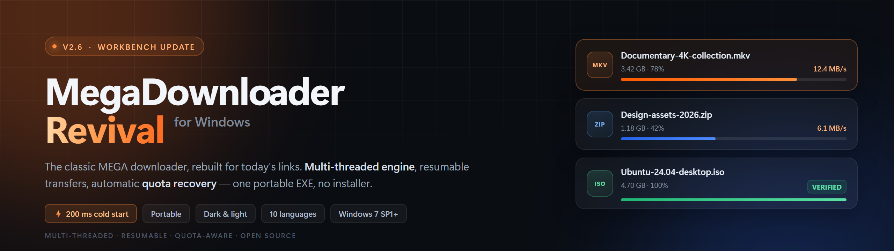
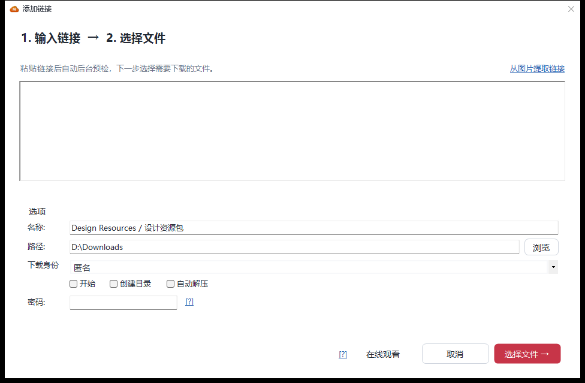
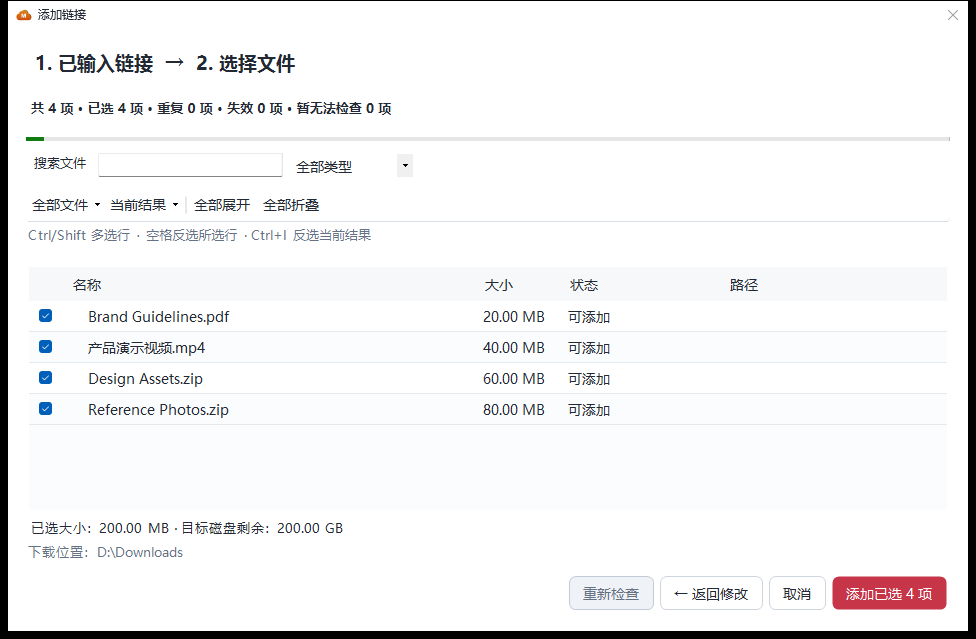
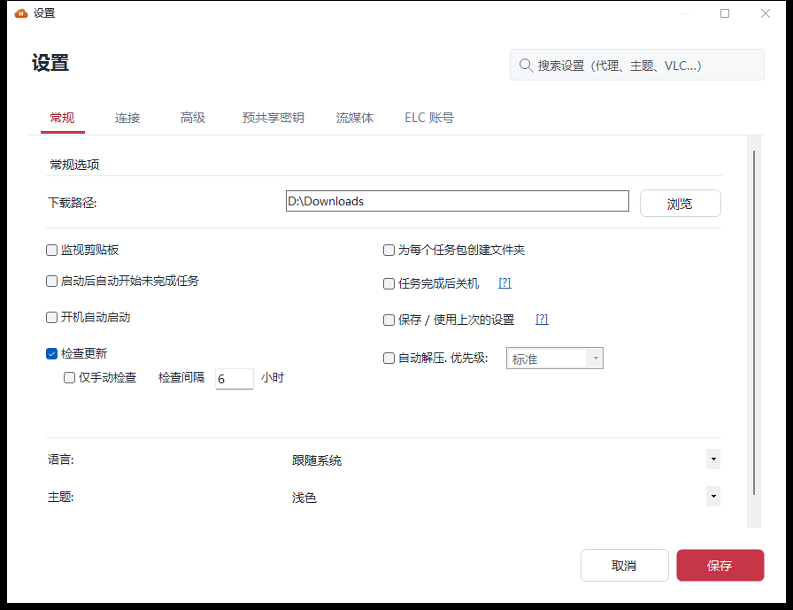
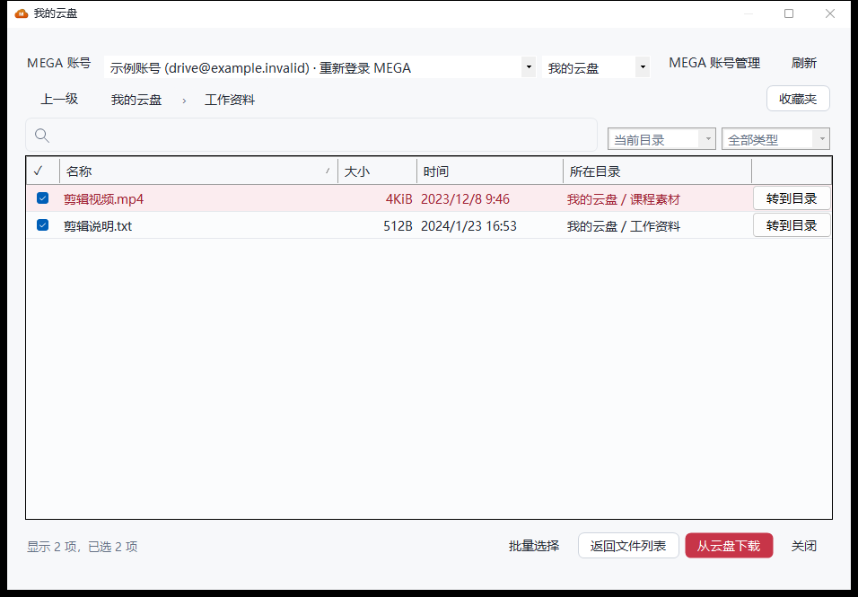
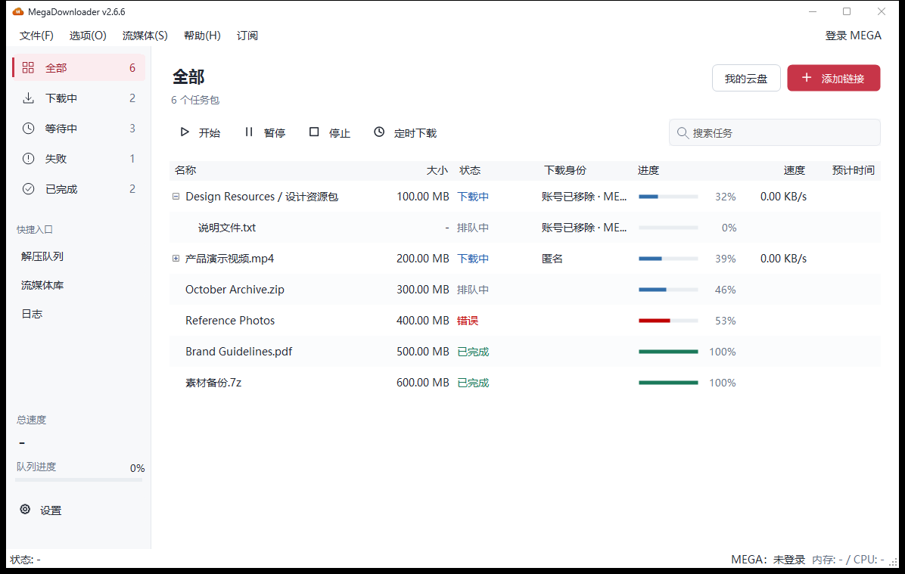

<p align="center">
  
</p>

<h1 align="center">MegaDownloader 复活计划</h1>

<p align="center">
  <b>经典 MEGA 下载器，为今天的链接重建。</b><br>
  粘贴 <code>mega.nz/file</code> 或 <code>mega.nz/folder</code> 链接，先选文件，再下载；支持续传和配额自动恢复。<br>
  Windows 免安装单文件 · 非官方项目，与 MEGA Ltd. 无关联。
</p>

<p align="center">
  <a href="../../../releases/latest"></a>
  <a href="CHANGELOG.md"></a>
</p>

<p align="center"><sub><a href="../README.md">English</a> · <b>简体中文</b> · <a href="README.ru-RU.md">Русский</a></sub></p>

<p align="center"><sub>如果这个项目帮到了你，欢迎<a href="https://github.com/a1175815821/MegaDownloader-Revival">点个 ⭐ Star</a>，让更多人发现它。</sub></p>

<p align="center">
  <a href="../../../releases/latest"></a>
  <a href="../../../releases"></a>
  
  <a href="../LICENSE"></a>
  <a href="../../../stargazers"></a>
</p>

## 30 秒开始下载

1. 下载 `MegaDownloader.exe`，双击运行；免安装、无需管理员权限。
2. 复制一个 MEGA 链接，程序会自动识别。
3. 确认链接 → 勾选要的文件 → 开始下载。

> v2.6.7 重点：在下载预检里直接订阅公开分享目录，可选择补齐已有文件或只接收今后的新增和更新；每个订阅可用匿名或指定的 MEGA 账号下载。

<table>
<tr>
  <td align="center" width="50%"><b>1. 粘贴链接</b><br></td>
  <td align="center" width="50%"><b>2. 预检并选择文件</b><br></td>
</tr>
</table>

<p align="center"><sub>界面示例数据，用于说明操作流程。用得上，欢迎<a href="https://github.com/a1175815821/MegaDownloader-Revival">点个 ⭐ Star</a>；更多功能见下方「它能做什么」。</sub></p>

---

## ✨ 2.6.7 新在哪

- **公开分享订阅**：在添加链接的预检里选中公开分享中的目录，点「订阅此目录…」。这一批仍可照常下载，订阅单独决定是补齐已有文件还是只跟踪今后的新增与更新。保存前显示匹配数量、已在队列与已下载数量，以及本次实际加入多少。
- **每个订阅指定下载身份**：公开订阅可以用匿名，也可以固定用某个 MEGA 账号下载。目录始终通过公开链接检查，账号退出登录也不会漏掉新文件；等待该账号的任务显示「等待 MEGA 账号登录」。更改身份只影响之后入队的文件。
- **一个订阅窗口**：来源列表新增「公开分享」，公开订阅与各账号的云盘订阅一起管理：逐个文件的变化与状态、立即检查、修改设置、打开实际下载位置，取消订阅也不会删除已入队任务或本地文件。
- **账号下载支持公开文件夹子文件**：公开文件夹里的文件现在可以交给选定的 MEGA 账号传输，不再只支持独立的公开文件链接。
- **下载与完成校验更快**：下载热路径改用缓冲池与系统 AES 批量解密；MetaMAC 校验改为整 chunk CBC + 顺序读并行算。512MiB 文件校验从 3.64s 降到约 0.20s，大队列界面也更跟手。
- **验证**：Release 完整回归 63 个用例、**1434 项断言**与界面专项 372 项断言全部通过。[完整变更](CHANGELOG.md)。

## 2.6.6 新在哪

- **云盘目录订阅**：把收藏的云盘目录设为订阅，指定每日检查时间与需要的扩展名，新增或更新的文件可自动入队，也可先确认。订阅窗口按账号列出全部绑定目录，以及新增、更新、待确认、已入队与已下载的文件，并保留云端子目录结构。
- **队列详情说明等待原因**：区分手动暂停、计划等待、匿名配额、账号配额与账号过期，并显示已知的重试时间；任务包可直接跳到第一个失败文件。
- **安全**：导入流媒体库不再解析 DTD 与外部实体，堵住读取本机文件与 SSRF 的路径；媒体库的名称、海报与编号按数据处理而不是拼进页面，关闭了库页面的存储型 XSS。
- **界面**：配额与失败横幅不再盖住工作台标题；关闭失败横幅只隐藏你已看到的那批失败；保存设置不再把日志级别重置为「最小」；关闭自动检查更新时，手动检查的结果不会再被抹掉。
- **后台**：队列用短快照渲染，不再长时间占着共享锁；自动关机在界面线程检查窗口；网页远控添加链接失败会返回错误，而不是让页面一直转圈；连续导入多个链接容器不再丢链接或重复导入。
- **翻译补全**：9 个缺项语言包补齐 1,430 条文案，11 个内置语言包现在都覆盖同样的 684 个键。[完整变更](CHANGELOG.md)。

> 账号下载需要 64 位 Windows 进程。两种发布包均自带 x64 MEGA 账号模块与所需的 VC++ 运行库。32 位 Windows 仍可匿名下载。

## 2.6 引入的工作台功能

> **一个窗口，两步操作，不用猜。**
>
> ⚡ **队列后台恢复** · 500+ 个文件导入不卡界面
>
> 启动时间因硬件和运行环境而异。

<table>
<tr>
<td width="50%" valign="top">

<b>🖥️ 工作台重做</b>

深浅色共用一套间距、字阶与图标网格。「添加链接」终于成了主操作，侧栏分组各自计数，详情栏可以收起，把宽度让给列表。

</td>
<td width="50%" valign="top">

<b>➕ 两步添加</b>

先在同一个窗口里粘链接，再挑文件，不再层层叠弹窗。点返回，链接、搜索词、展开的目录和勾选全都还在。

</td>
</tr>
<tr>
<td valign="top">

<b>🗂️ 批量预检</b>

下载之前先看清文件名、大小、状态和相对路径。文件夹树可折叠，支持名称搜索、类型筛选、Ctrl/Shift 多选，并显示选中总大小与目标磁盘剩余空间。

</td>
<td valign="top">

<b>🔎 任务搜索</b>

<kbd>Ctrl</kbd>+<kbd>F</kbd> 搜索任务包名、文件名或相对路径，并与当前状态分组叠加过滤；<kbd>Esc</kbd> 清空后恢复整个队列。

</td>
</tr>
<tr>
<td valign="top">

<b>⏰ 定时下载</b>

一次性预约或每日下载时段，支持跨午夜。时段开始自动恢复，结束时自动暂停，配置重启后沿用。

</td>
<td valign="top">

<b>⚡ 启动保持响应</b>

首屏不再同步读性能计数器与 WMI；2.6.2 起先显示主窗口，再后台恢复队列。链接解析、建包与元数据检查也移出了界面线程，预检采用虚拟列表。

</td>
</tr>
</table>

<details>
<summary><b>2.6 的其余改动与背后的修复</b></summary>

<br>

- **重复识别**：按文件 ID + 密钥识别新旧格式的重复链接，并检查现有队列；重复与失效项始终跳过。
- **临时故障与永久失效分开处理**：网络抖动导致检查不了的普通链接，仍可手动勾选添加。
- **确认期间的新链接**先暂存到下一批，不会被静默下载。
- **大任务包**（超过 500 个文件）默认折叠，导入瞬间不会卡住列表。
- **添加完成后**自动切到全部任务并定位最新任务包；文件树保留仍可见行的高亮与滚动位置。
- **过程可见可停**：解析阶段显示已用时间、可停止 / 重检；提交阶段单独显示「加入下载队列」。
- **DPI 与主题修复**：高 DPI 文件夹展开标记、详情滚动后的布局偏移、原生列表背景与空态换肤、带格式粘贴不再带入网页字色。
- **定时控制队列**：在设定时段内恢复下载，时段结束后暂停；手动暂停整队列会持续到下一时段。

</details>

---

## 📦 下载选项与系统要求

从 [Releases](../../../releases/latest) 下载，二选一：

| 文件 | 适合你，如果…… |
| --- | --- |
| **`MegaDownloader.exe`**（单文件） | 想要最省事：下载后直接双击运行，15 个依赖 DLL 已内嵌 |
| **`MegaDownloader-Revival-win-x86.zip`**（免安装包） | 喜欢压缩包：解压后运行程序 |

需要 Windows 7 SP1 及以上、.NET Framework 4.8（Windows 10 1903+ 已内置，旧系统按提示安装）；免安装、无需管理员权限。

除剪贴板自动识别外，还可把链接拖进窗口、使用工具栏「添加链接」，或在浏览器中点击 `mega://` 协议链接。

---

## 🚀 它能做什么

**下载核心**

- **多线程加速** —— 同一文件多路并发连接，吃满带宽
- **真断点续传** —— 暂停 / 恢复 / 出错重试，重启程序接着下，中断的半成品会被复用
- **文件夹下载** —— 递归解析整个分享文件夹，可只选其中部分子文件夹或文件
- **限速** —— 全局限速，匿名任务还可单独限速
- **失败自愈** —— 失败任务定时自动重试，永久失败自动排除（v2.5）
- **配额熔断** —— MEGA 配额耗尽时自动暂停并倒计时，到点自动恢复；旧版「配额突破」持续重试模式仍可开启，默认关闭（v2.5）
- **自动解压** —— 下完自动解压 RAR / 7Z / ZIP，支持分卷与密码，且不会覆盖已有同名文件
- **成品校验** —— 链接包含 MetaMAC 时，下载文件会先经过校验，再标记为完成（v2.5.9）
- **MEGA 账号** —— 登录一个或多个账号，用账号下载公开链接，配额用尽时自动换账号；公开文件夹中的子文件也可指定账号下载（v2.6.5 / v2.6.7）

**链接接入**

- **四种方式** —— 剪贴板自动识别 · 拖拽 · 手动粘贴 · `mega://` 协议
- **批量预检** —— 大型分享先看清再勾选，不再盲下（v2.6）
- **ELC 容器** —— 加密链接容器的导入与导出；`enc` / `enc2` / `fenc` / `fenc2` / `elc` 全支持
- **云盘** —— 浏览我的云盘与分享目录，绑定本地目录后检查新增与更新文件（v2.6.5）
- **目录订阅** —— 按每日计划检查绑定目录，新增与更新的文件可自动入队（v2.6.6）
- **公开分享订阅** —— 预检里选中公开目录即可订阅；可补齐已有文件或只接收今后的更新，按订阅指定的匿名或 MEGA 账号下载（v2.6.7）

**工作台**

- **启动保持响应** —— 队列恢复与文件锁重试放到后台，不再阻塞读 WMI 与性能计数器（v2.6.2）
- **任务搜索** —— 包名、文件名、路径，`Ctrl+F` 直达（v2.6）
- **定时下载** —— 每日时段或一次性预约（v2.6）
- **详情栏可收起** —— 队列统计、任务列表、详情三段式，窄窗口自动让出空间
- **深 / 浅色主题** —— 跟随系统，也可手动指定
- **11 种界面语言** —— English · Español · 简体中文 · 繁體中文 · Русский · Français · Deutsch · Italiano · Português (BR) · Magyar · Română
- **Web 界面** —— 内置 HTTP 服务，浏览器远程添加任务、查看进度；可开启局域网访问，用手机推送下载

**附加能力**

- **边下边播** —— 集成 VLC，流式播放尚未下完的视频
- **流媒体库** —— 可视化管理常看的流媒体资源
- **隐写工具** —— 用图片 / 视频藏文件（F5 隐写）

<details>
<summary><b>支持的全部链接格式</b></summary>

<br>

- 新版：`mega.nz/file/ID#KEY`、`mega.nz/folder/ID#KEY`（v1.9 起），含分享内的子文件夹与单文件链接
- 旧版：`mega.nz/#!ID!KEY`、`mega.co.nz/#F!ID!KEY`
- 加密：`mega://enc?…`、`mega://enc2?…`、`mega://fenc?…`、`mega://fenc2?…`、`mega://elc?…`

```
https://mega.nz/file/abcDEFgh#IjklMNopQRstUVwxYZ1234567890
https://mega.nz/folder/abcDEFgh#IjklMNopQRstUVwxYZ1234567890
https://mega.nz/#!abcDEFgh!IjklMNopQRstUVwxYZ1234567890
mega://enc?_xlPqemSILarh5VBKbhSTFyQQQ0
```

> v2.0 起移除对已下线服务的支持：MegaCrypter、YouPaste、LinkCrypter、EncrypterMe.ga、goo.gl 短链。

</details>

---

## 🖼️ 界面

**两步添加，下载前先看清**

<table>
<tr>
  <td align="center" width="50%"><b>1. 粘贴链接</b><br></td>
  <td align="center" width="50%"><b>2. 预检并选择文件</b><br></td>
</tr>
</table>

<p align="center">
  <picture>
    <source media="(prefers-color-scheme: dark)" srcset="screenshots/settings-dark.png">
    <source media="(prefers-color-scheme: light)" srcset="screenshots/settings-general.png">
    
  </picture>
</p>
<p align="center"><sub>2.6.6 设置 · 语言跟随系统，表单可滚动。截图使用示例数据。</sub></p>

<table>
<tr>
  <td align="center" width="50%"><b>云盘</b><br></td>
  <td align="center" width="50%"><b>按任务选择下载身份</b><br></td>
</tr>
</table>

<p align="center"><sub>账号与云盘截图为示例数据，未连接真实 MEGA 账号。</sub></p>

---

## 📖 这个项目从哪来

MegaDownloader 是西班牙开发者 **Andres Soliño** 制作的 MEGA 下载管理器，以轻量、稳定、多线程著称。原项目在 v1.8 后停止维护，而 MEGA 更换了链接格式（`mega.nz/file/...`、`mega.nz/folder/...`），旧版无法识别新链接，核心功能失效。

本仓库把它救了回来：反编译 v1.8 拿到源码，在此基础上持续修复与重构 —— 至今累计 **200+ 项修复与加固**（崩溃、静默丢数据、安全、兼容性），并按语义化版本持续发布。

|  | 原版 v1.8（2018 年停更） | **本仓库 v2.6.7** |
| --- | --- | --- |
| 新版 `mega.nz/file` / `/folder` 链接 | ❌ 无法识别 | ✅ v1.9 起支持 |
| MEGA 配额耗尽 | 卡死、报错 | ✅ 自动熔断，倒计时恢复（v2.5） |
| 失败任务 | 只能手动重试 | ✅ 定时自愈（v2.5） |
| 添加大型分享 | 粘完就下，全凭运气 | ✅ 批量预检 + 文件夹树（v2.6） |
| 找任务 | 整队翻找 | ✅ 按包名 / 文件 / 路径搜索（v2.6） |
| 无人值守下载 | — | ✅ 每日时段或一次性预约（v2.6） |
| 登录账号下载 | — | ✅ 多账号、云盘、私有文件断点续传（v2.6.5） |
| 启动体验 | 首屏同步阻塞 | ✅ 先显示窗口，再后台恢复队列（v2.6.2） |
| 界面主题 | 仅系统灰 | ✅ 深 / 浅色，跟随系统（v2.0） |
| 稳定性 | — | ✅ 200+ 项崩溃 / 丢数据 / 安全修复 |
| 维护状态 | 已停更 | ✅ 活跃维护，Issue 有响应 |

> ⚠️ **法律声明**：本项目源自对第三方已发布软件的反编译，目的仅在于修复兼容性问题以恢复其可用性。若原作者认为本仓库侵犯其权益，请通过 Issue 联系，我们将配合处理。

---

## ❓ 常见问题

**提示配额不足 / quota exceeded？**
MEGA 对免费账户和 IP 有下载配额限制。v2.5 起程序会自动暂停并倒计时恢复；等不及的话，可在设置中开启「配额突破模式」持续重试。

**能用自己的 MEGA 账号下载吗？**
启用 Windows x64 账号模块后，可以从右上角添加多个 MEGA 账号、设置别名和默认账号，并查看 MEGA 返回的套餐、存储用量和传输配额。添加公开单文件时可选择账号或匿名下载，队列支持查看和批量更改任务身份。当前账号耗尽传输配额时，任务会尝试下一个可用账号。文件夹和 ELC 链接继续使用原有下载流程。见[构建与启用说明](../Native/MegaAccount/README.md)。

**配置和下载队列存在哪？**
`%LOCALAPPDATA%\MegaDownloader\`。程序目录可以随意搬动或删除，配置不受影响；重装系统前备份这个目录即可。

**旧格式链接还能下吗？**
能。新旧格式、`mega://` 加密链接、ELC 容器都支持，完整清单见上方折叠块。

**需要管理员权限吗？**
不需要。免安装、免管理员。

**有 Mac / Linux 版吗？**
没有 —— 基于 WinForms，仅限 Windows。但可开启内置 Web 界面，用手机或其他设备的浏览器远程管理下载。

**定时下载会唤醒电脑吗？**
不会。程序必须保持运行，不注册唤醒定时器、也不作为后台服务运行。

**发现安全问题？**
请不要公开提 Issue，按 [SECURITY](../SECURITY.md) 里的方式反馈。

---

## 🛠️ 给开发者

<details>
<summary><b>从源码构建</b></summary>

<br>

**环境要求**：Visual Studio 2019 或 2022 · .NET Framework 4.8 开发人员包· Windows 7 SP1+

```bash
git clone https://github.com/a1175815821/MegaDownloader-Revival.git
cd MegaDownloader-Revival
# 用 Visual Studio 打开 MegaDownloader.sln，然后 Ctrl+Shift+B
```

命令行构建：

```bash
msbuild MegaDownloader.sln /p:Configuration=Release /p:Platform=x86
```

产物位于 `bin/<Configuration>/MegaDownloader.exe`。构建配置：`Debug` / `Release` / `Debug_MSD` / `Release_MSD`（MegaSearchDesktop 集成版，输出到 `Resources/Installer MSD/`）。

回归验证：在 PowerShell 中运行 `.\Tests\Run-RegressionTests.ps1`（需要 .NET SDK）。测试使用临时文件与本机 HTTP 服务，无需 MEGA 账号。详见 [Tests/README.md](../Tests/README.md)。

构建时会压缩并内嵌 `Native/MegaAccount/prebuilt/x64/` 中预构建的 x64 MEGA 账号模块，常规发版直接复用。重建方法见 [Native/MegaAccount/README.md](../Native/MegaAccount/README.md)。

**技术栈**：VB.NET · .NET Framework 4.8 · WinForms · BouncyCastle（加密）· Newtonsoft.Json · ObjectListView · SharpCompress（解压）· HttpServer/Fadd（Web）· F5Lib（隐写）

</details>

<details>
<summary><b>项目结构</b></summary>

<br>

```
MegaDownloader/
├── Clases/                 # 核心类库（加密、下载、配置、主题、预检、定时）
├── Controls/               # 自定义控件
├── Forms/                  # WinForms 窗体（工作台、两步添加流程等）
├── HttpModule/             # 内置 Web 服务器模块与 HTML 模板
├── Stegano/                # 隐写术窗体
├── Resources/
│   ├── DLLs/               # 第三方 DLL 依赖
│   ├── Language/           # 多语言 XML（11 种）
│   └── Installer MSD/      # WiX 安装包工程
├── docs/                   # 文档、截图
├── Tests/                  # 下载、解压与流媒体回归验证
└── MegaDownloader.sln
```

完整目录树与文件说明见 [CONTRIBUTING](CONTRIBUTING.zh-CN.md)。

</details>

---

## 📚 文档

| 文档 | 内容 |
| --- | --- |
| [CHANGELOG](CHANGELOG.md) | 完整版本历史与每版修复明细（简体中文，权威源） |
| [CONTRIBUTING](CONTRIBUTING.zh-CN.md) | 贡献流程、代码风格、发布流程 |
| [SECURITY](../SECURITY.md) | 安全问题反馈方式 |
| [CODE OF CONDUCT](../CODE_OF_CONDUCT.md) | 社区行为准则 |
| [2.6.7 发行说明](https://github.com/a1175815821/MegaDownloader-Revival/releases/tag/v2.6.7) | v2.6.7 的更新亮点与下载 |

README 为三种语言手动维护；CONTRIBUTING 有英文与简体中文两个版本，CHANGELOG 为简体中文。更新时请同步：

| 语言 | README | CHANGELOG | CONTRIBUTING |
| --- | --- | --- | --- |
| English | `README.md`（根目录） | `docs/CHANGELOG.md` | `docs/CONTRIBUTING.md` |
| 简体中文 | `docs/README.zh-CN.md` | `docs/CHANGELOG.md` | `docs/CONTRIBUTING.zh-CN.md` |
| Русский | `docs/README.ru-RU.md` | `docs/CHANGELOG.md` | `docs/CONTRIBUTING.md` |

---

## ⭐ 支持这个项目

如果 MegaDownloader Revival 帮到了你，这几件事最有帮助：

- ⭐ **点个 Star** —— 这是让项目被更多人看到的最直接信号
- 🐛 [提 Issue](../../../issues) —— 近期的多个修复都来自用户报告
- 🌍 帮忙改进 [翻译](CONTRIBUTING.zh-CN.md) —— 已有 11 种语言，缺母语校对
- 🔗 分享给还在找 MEGA 下载工具的朋友

<a href="https://star-history.com/#a1175815821/MegaDownloader-Revival&Date">
 <picture>
   <source media="(prefers-color-scheme: dark)" srcset="https://api.star-history.com/svg?repos=a1175815821/MegaDownloader-Revival&type=Date&theme=dark" />
   <source media="(prefers-color-scheme: light)" srcset="https://api.star-history.com/svg?repos=a1175815821/MegaDownloader-Revival&type=Date" />
   
 </picture>
</a>

---

## 致谢

- 原 MegaDownloader 作者 **Andres Soliño**
- 复活计划维护者 **Yingxue**（v2.0+），以及所有提 Issue、补翻译的贡献者
- 开源依赖：[BouncyCastle](https://www.bouncycastle.org/) · [Newtonsoft.Json](https://www.newtonsoft.com/json) · [SharpCompress](https://github.com/adamhathcock/sharpcompress) · [ObjectListView](http://objectlistview.sourceforge.net/) · [7-Zip](https://www.7-zip.org/)

## 许可

基于 [MIT License](../LICENSE) 发布。原始版权 © 2018 Andres Soliño，复活计划修复版权 © 2026 MegaDownloader Revival Project 贡献者。

> 仓库内第三方 DLL 遵循各自原始许可证，使用者应自行确认合规性。
