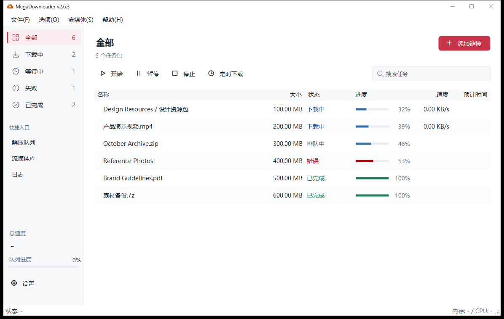

<h1 align="center">MegaDownloader 复活计划</h1>

<p align="center">
  轻巧的 Windows 版 MEGA 下载管理器。<br>
  支持断点续传、分享文件夹预览和大批量任务管理。
</p>

<p align="center">
  <a href="https://github.com/a1175815821/MegaDownloader-Revival/releases/latest"></a>
</p>

<p align="center">
  Windows 7 SP1 及以上 · .NET Framework 4.8 · 免安装、无需管理员权限
</p>

<p align="center">
  <a href="../README.md">English</a> · <strong>简体中文</strong> · <a href="README.ru-RU.md">Русский</a>
</p>

<p align="center">
  <a href="#快速上手">快速上手</a> · <a href="#功能">功能</a> · <a href="#常见问题">常见问题</a> · <a href="#开发与贡献">开发与贡献</a>
</p>

<p align="center"><sub>非官方项目，与 MEGA（MEGA Ltd.）无关联。</sub></p>

## 快速上手

1. 打开[最新发行版](https://github.com/a1175815821/MegaDownloader-Revival/releases/latest)，选择其中一种下载：
   - **`MegaDownloader.exe`**：单文件版本，依赖 DLL 已内嵌。
   - **`MegaDownloader-Revival-win-x86.zip`**：便携压缩包，解压后运行程序。
2. 运行程序。系统需要 Windows 7 SP1 或更新版本，以及 .NET Framework 4.8。
3. 点击**添加链接**，粘贴 MEGA 链接，选择需要的文件并确认。也可以使用剪贴板监控或拖拽添加链接。

## 界面

<p align="center">
  <picture>
    <source media="(prefers-color-scheme: dark)" srcset="screenshots/main-dark.png">
    
  </picture>
</p>

<p align="center"><sub>截图使用示例任务；界面支持深浅色主题和 11 种语言。</sub></p>

[添加链接](screenshots/add-links.png) · [选择文件](screenshots/preflight.png) · [更多截图](screenshots/README.md)

## 功能

- **可靠下载**：多连接下载、暂停与断点续传，重启后继续任务；失败任务可自动重试。
- **配额恢复**：MEGA 下载配额耗尽时暂停，倒计时结束后尝试恢复。
- **文件夹与批量下载**：预览分享目录，搜索和勾选文件，下载前查看选中总大小。
- **队列管理**：按名称或路径搜索，设置全局或单任务限速，安排一次性或每日下载时段。
- **自动解压与校验**：解压 RAR、7Z、ZIP 时保护已有文件；链接包含 MetaMAC 时校验下载结果。
- **多种接入方式**：通过剪贴板、拖拽或 `mega://` 添加链接，导入和导出 ELC 容器，也可使用内置 Web 界面管理下载。
- **其他工具**：配置 VLC 后边下边播、管理流媒体资源，以及使用内置隐写工具。

<details>
<summary>支持的链接格式</summary>

- 新版：`mega.nz/file/ID#KEY`、`mega.nz/folder/ID#KEY`，包括分享中的文件和子文件夹链接。
- 旧版：`mega.nz/#!ID!KEY`、`mega.co.nz/#F!ID!KEY`。
- 加密链接：`mega://enc`、`mega://enc2`、`mega://fenc`、`mega://fenc2`、`mega://elc`，以及 ELC 容器。

v2.0 起已移除对 MegaCrypter、YouPaste、LinkCrypter、EncrypterMe.ga 和 goo.gl 短链的支持。

</details>

## 最近更新

**2.6.2** 将队列恢复移至后台，删除任务时保护已有文件，改进续传和重试行为，并新增俄语界面。详情见[最新发行说明](https://github.com/a1175815821/MegaDownloader-Revival/releases/latest)和[完整更新日志](CHANGELOG.md)。

## 常见问题

### 提示 MEGA 配额不足怎么办？

程序会暂停队列，并在倒计时结束后尝试恢复。配额由 MEGA 控制；设置中仍保留旧版持续重试模式，默认关闭。

### 配置和下载队列存在哪里？

保存在 `%LOCALAPPDATA%\MegaDownloader\`。重装 Windows 前请备份该目录；移动程序文件夹不会移动这些配置。

### 支持 macOS 或 Linux 吗？

程序运行在 Windows 上。开启可选的 Web 界面后，可以通过其他设备的浏览器管理下载。

### 定时下载会唤醒电脑吗？

不会。定时下载时程序需要保持运行，电脑也需要处于唤醒状态。

## 开发与贡献

在 Windows 上构建需要 Visual Studio 2019 或 2022，以及 .NET Framework 4.8 开发人员包。在 **Visual Studio 开发人员 PowerShell** 中运行：

```powershell
git clone https://github.com/a1175815821/MegaDownloader-Revival.git
cd MegaDownloader-Revival
msbuild MegaDownloader.sln /p:Configuration=Release /p:Platform=x86
```

构建产物位于 `bin/Release/MegaDownloader.exe`。运行回归检查还需要安装 .NET SDK：

```powershell
.\Tests\Run-RegressionTests.ps1
```

更多信息见[贡献指南](CONTRIBUTING.zh-CN.md)、[回归验证说明](../Tests/README.md)和[行为准则](../CODE_OF_CONDUCT.md)。欢迎通过 [Issues](https://github.com/a1175815821/MegaDownloader-Revival/issues)反馈问题或改进翻译；安全问题请按照 [SECURITY.md](../SECURITY.md) 反馈。

## 项目来源与许可

MegaDownloader 最初由 Andres Soliño 开发。本复活计划基于 v1.8 的反编译源码维护，目的是恢复对 MEGA 新版链接的兼容性。感谢原作者、维护者 Yingxue，以及所有提交修复、反馈和翻译的贡献者。

项目基于 [MIT License](../LICENSE) 发布，第三方组件遵循各自的许可证。版权归属和项目来源详见 [NOTICE](../NOTICE)。若原作者认为本仓库侵犯其权益，请通过 Issue 联系维护者，我们会配合处理。

<p align="center"><sub>如果这个项目对你有帮助，欢迎点个 ⭐ 支持。</sub></p>
